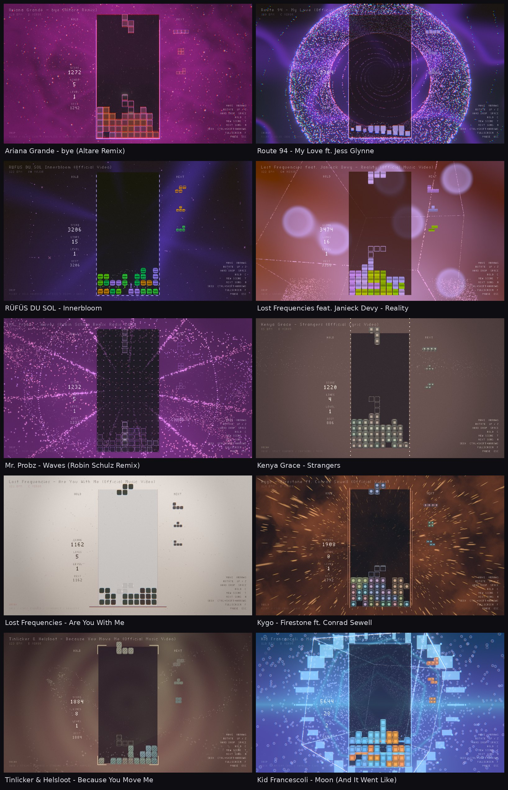

# Zentris

A Tetris game inspired by **Tetris Effect**, but playing **any playlist you like**: your own music folder or
a YouTube playlist. Each song is analysed ahead of time (tempo, key, structure: intro, verse, build,
chorus, drop...) and the game stages it: pieces fall on the beat, the pace follows the song's energy, and
a procedurally generated 3D scene evolves with every section. Built in C++ / OpenGL 3.3.



*Nine scenes generated by the game. Every song, and every run, gets its own scene.*

## Install

[](https://pypi.org/project/zentris/)

Prebuilt packages for Linux, macOS (Intel and Apple Silicon) and Windows are on
[PyPI](https://pypi.org/project/zentris/).

Run it directly with [uv](https://docs.astral.sh/uv/), without installing:

```sh
uvx zentris                              # the default playlist
uvx zentris ~/Music
uvx --from zentris zenscope ~/Music      # the analysis viewer
uvx --from zentris zenscene              # the scene viewer
```

Or install it with [pipx](https://pipx.pypa.io/) (or `uv tool install zentris`):

```sh
pipx install zentris
zentris                     # with no argument it plays the default YouTube playlist
zentris ~/Music             # or any folders, files and YouTube playlist/video URLs
zenscope ~/Music            # the analysis viewer
zenscene                    # the scene viewer
```

Quote YouTube URLs: `&` is special in the shell. The package brings [yt-dlp](https://github.com/yt-dlp/yt-dlp)
and an ffmpeg build for YouTube playlists; YouTube also needs a JavaScript runtime
([Deno](https://deno.com) or Node.js) on your system.

## Build from source

Dependencies (Debian/Ubuntu): `sudo apt install cmake g++ libglfw3-dev libglew-dev`
(miniaudio and stb are vendored in `third_party/`).

```sh
cmake -S . -B build && cmake --build build -j
./build/zentris audio           # plays every .mp3/.wav/.flac in ./audio, in random order (--in-order to keep it)
./build/zentris song.mp3 ~/Music --fullscreen
```

YouTube playlists (or single videos) work too, through [yt-dlp](https://github.com/yt-dlp/yt-dlp)
(install it with `pipx install "yt-dlp[default]"`; YouTube also needs a JavaScript runtime such as Deno or
Node.js, and Node.js is picked up automatically). Songs are downloaded when queued and cached as MP3 in
`~/.cache/zentris/youtube/`. Downloading from YouTube is against its terms of service: personal use only.

```sh
./build/zentris "https://www.youtube.com/playlist?list=PLWHPu2N_Gb2lbZ8-7sYKSEbDlb3UiAVye"   # quote it: & is special in the shell
./build/zenscope "https://www.youtube.com/watch?v=..."
```

Other options: `--in-order` (play songs in order: folders alphabetically, playlists in their order; the default is a random order), `--seed N` (repeat a run), `--scene CODE` (show again the scene whose code is in the bottom-left corner, with any song; with the same song, given as in the command the terminal prints, its calm/peak levels also come back at the same times), `--autoplay`, `--mute`, `--size WxH`,
`--shots PREFIX N` (renders N screenshots of different scenes and exits), `--phase-shots PREFIX` (one screenshot per scene level of a song),
`--clip OUT.mp4` (records a video with sound, via ffmpeg, from 4 s before the first drop of the song to 6 s after it,
with the game played at a calm pace; `--clip-before` / `--clip-after SEC` change the span).

`tools/scenereview.py` reviews scenes: `generate` renders 100 random scenes (each made for a downloaded song, at a
calm, mid or peak part of it, with a filled board; `zentris --review-shot OUT.png` makes one), and `serve [--lan]`
opens a dashboard, on a computer or a phone, to skip scenes or comment on them. Comments become threads that
`pending` / `watch` hand to whoever processes them, and `reply` answers one with before/after snapshots to accept
or discuss further.

`tools/promo.py [OUT.mp4]` makes a promo video: 5 random songs of the default playlist, each recorded around its
first drop in a random scene, stitched with crossfades (`--songs N`, `--before`, `--after`, `--fade`, `--size`).

## zenscope: see what the game hears

`./build/zenscope [songs or folders...]` (the default playlist when no song is given) plays a song and shows the analysis that drives the game:
- a phase timebar with the scene levels (calm / mid / peak) and where the scene changes happen
- the detected structure: intro, verse, build, chorus, drop, break, outro, with similar parts grouped
- pulse zones, a 16-band spectrum, loudness, intensity and onsets, and bar lines
- a live readout of the current section and the game's density/speed/glow profile, with the beat in the bar
- a zoomed detail view with the beat grid
- four beat-aligned samples cut from the song (an experiment for line clears, not used by the game yet):
  HIT (one clean transient, 1 beat), LOW (a bass-led half bar), TONE (a sustained, steady half bar) and
  HOOK (the first bar of the most repeated chorus/drop)

Space plays/pauses, Left/Right seek 5 s, Up/Down zoom the detail view, N/P change song, click to seek,
1–4 or a click on a sample button plays that sample (over the song, or alone when paused).
The SPEED buttons (top right) slow the song down to ×0.9 or ×0.5, tape-style (the pitch drops too);
click the active one again to go back to normal speed.

**Notes:** press A to write a note at the playhead (e.g. "the drop should start earlier here"); Enter saves it,
Esc cancels (the song pauses while you type). Notes go to `annotations.jsonl` in the user data folder
(`~/.local/share/zentris/` on Linux; `--notes FILE` to change it), one JSON object per line with the song, the time,
the text and what the analysis said there (the phase and section, and the whole scene plan and structure).
They show as cyan flags on the timeline, with their text in the detail view.
`--song ID|TITLE` starts at a song of the playlist (a YouTube id or part of its title), `--at SEC` at a time, and
`ytdl:<video id>` plays a single YouTube song, and `--shuffle` plays the songs in a random order. Playlist listings are cached (and refreshed in the background for the
next run) and songs stay downloaded in the cache, so reopening an annotated song is instant and works offline.

The game and zenscope share the same analysis and song plan code (`src/songplan.*`), so what you see is what the game uses.

## zenscene: adjust a scene

`./build/zenscene [CODE]` shows a scene (a random one, or the one of a scene code) while the computer plays. The menu
on the left picks the song phase (section and level: calm, mid, peak) and pins any choice of the scene: mood, palette,
hue, background, particle layouts, surface, block style and shape, frame, lock effect. Up/Down choose a row,
Left/Right (or a click / the mouse wheel) change it and pin it, Space pins or unpins it as it is, C unpins
everything, R shows a new random scene (pinned choices stay, options switched off are never picked) and F fills the
board. "Send to dashboard" (or D) asks for a comment
and opens a thread on the scene in the scene review dashboard (`tools/scenereview.py`, "to process"), with a snapshot
at the section and level shown.

A scene code is the scene's choices, two hex digits each in the menu's order (mood, palette, hue, background,
particles, particles 2, surface, blocks, shape, frame, lock effect): `010301101d000200020105` is DUSK, MONOCHROME,
hue 15°, DIAGONAL background, BUBBLES, no second layout, SILK, GLASS blocks, ORB shape, CORNERS frame, PRESS. Everything else about the scene comes from a seed made of those choices, so a code always gives the same
scene, whatever the song. The terminal prints the code after each change; `zentris --scene CODE` shows it in the game.

Options can be switched off (X, or the ON/OFF tag; `--disabled` lets the menu offer them too): scenes never pick
them, but a code that uses one still shows it. The list is `src/scene-options.txt`, built into the game.

## Controls

Keyboard and gamepad both work at the same time. A gamepad is detected at startup and on hot-plug,
and the on-screen hints follow whichever device you used last.
Controllers are recognised through the bundled [SDL_GameControllerDB](https://github.com/mdqinc/SDL_GameControllerDB)
(`third_party/gamecontrollerdb.txt`; extra mappings can be given in `SDL_GAMECONTROLLERCONFIG`). A controller
missing from it still works with a generic layout.

| Action | Keyboard | Gamepad |
|---|---|---|
| Move | ← → | D-pad / left stick |
| Soft / hard drop | ↓ / Space | Down / Up |
| Rotate | ↑ or X (Z or J to rotate left) | A (B/X to rotate left) |
| Hold | C / Shift (tap) | LB / RB |
| Slow motion (when the gauge is full) | V / E | ZL / ZR (LT / RT) |
| New scene | T | Y |
| Next song | N / Tab / Enter / PageDown | Back |
| Seek ±10 s in the song (testing) | Ctrl+Shift+Left/Right | |
| Next level (debugging) | L | |
| Fill the bonus gauge (testing) | B | |
| Pause | Esc / P (Q quits while paused) | Start |
| Fullscreen | F / F11 | |

## Slow motion and Tetris rewards

Each cleared line charges one step of the bonus gauge, a ring below the next pieces (12 steps to fill it; a
Tetris charges 5). Once it's full, the slow-motion button starts the bonus: for 10 s the gauge drains, the
game slows down to ×0.25 (pieces fall four times slower) while the song keeps playing normally: only a very
slight tape-like slow-down (and back) marks the start and the end. Use it to clean up the stack in a part that's too fast. Gravity gets
back on the beat when the bonus ends. Meanwhile the screen's colors are reversed (swept in and out from the
board) and the scene slows down, with one animation from a pool (halo, hourglass, ripples, orbits, stasis,
ribbons, clock).

A Tetris scores a 400-point bonus (800 back-to-back) and plays a celebration from another pool (pillars,
blooms, spiral, waves, starfall, frame trace, light sheet); a back-to-back Tetris plays two at once.

## How the music shapes the game

Each song is decoded and analyzed in the background (under 1 s):

- **Tempo and song sections**: gravity follows the beat, at a pace set by the current section, in rows per beat: break ×0.4, intro ×0.5, outro ×0.5, verse ×0.8, build ×1, chorus ×1.2, drop ×1.3 (at most ×1 in a song's first 20 s).
- **Levels**: one level per 20 lines, up to a plateau at level 20. Each level speeds up the beat-locked gravity (×10 at the plateau, capped at 28 rows/s) and shortens the lock delay (0.55 s → 0.35 s). Game over resets the level.
- **Key**: the base hue follows the circle of fifths.
- **Brightness, bass/air balance, dynamics, density**: choose the mood (night, dusk or pale), the particle layouts, bloom, how strongly things react, and the camera's motion.
- **Song structure**: the song is split at bar lines into labelled segments (intro, verse, build, chorus, drop, break, outro), and segments that sound alike are grouped. A section that gets louder starts where it lands, on the first beat where its bass and loudness are back (after the gap, bass cut or riser before a drop), and a drop is the song's most intense material entered by a rise. Each segment eases the scene's density, speed, glow and saturation (builds ramp up, breaks thin out).
- **One identity per song**: background, main particles, blocks, frame and mood stay the same for the whole song. At most three intensity levels (calm, mid, peak) shift the hue slightly and add color, glow or an extra particle layer. Changes happen only when the level changes, crossfading over 8 s, and never interrupt each other.
- **Calm by design**: visuals follow slow (~1 s) envelopes of the music and there is no camera shake or flashing. Beat pulses appear only during peak sections (choruses, drops), stronger for faster songs; songs above ~110 BPM also get soft hits on strong transients there.
- **Live bands and loudness**, heavily smoothed, drive particle motion and glow.

The scene seed combines the song's fingerprint with a random seed for each run, so the same song looks
different every time. The combinatorial space covers 8 palette schemes × 3 moods, 24 backgrounds,
44 particle layouts (elements like rain, wind, fire and sea; some shaped by the live spectrum: skyline, corona, dunes, wall, halos) × 20 particle shapes (none, one or two layers), 17 continuous surface layers (smoke, silk, lava, caustics, ink, geometry, aurora, fog, beams, flowing rings, liquid, cloud shades, voronoi cells, water, low-poly facets, hexagon tiles, glass shards), 22 block materials × a continuous family of
block shapes (cube → rounded → sphere → gem), 18 board frames, light rays, 22 line-clear effects, 25 transition shapes, and a
post-processing grade (bloom, vignette, chromatic aberration, grain, split-toning).
The scene name is shown in the bottom-left corner.

## Universes

Each song is played in a **universe**: a complete, hand-directed art direction with its own world, palette,
materials, HUD style and its own way of staging the music (beats, kicks, calm / mid / peak levels, line clears,
Tetris, slow motion, game over). A universe is one world, not a set of random options. The song chooses
the intensity inside that world, never a different world.

The list below is the roadmap, in implementation order: after the first three, it goes from the most generic
universes (atmospheres that fit almost any song) to strongly styled ones, and keeps the most specific or exotic
ideas for the end. Universes marked ✅ exist, the others are ideas waiting to be built.

| # | Universe | Look | How the music plays it | Status |
|---|---|---|---|---|
| 1 | SUMI | Ink on washi paper, sumi black + one vermilion seal; brushed pieces told apart by ink treatment | Beats diffuse ink in the paper; calm = faint far mountain, peak = ensō brush circle and red sun; a clear is one brush stroke | ✅ |
| 2 | VECTOR | Phosphor beams on black CRT glass, one phosphor per song, persistence trails; pieces are line glyphs | Calm = a lone oscilloscope trace; mid = scrolling vector grid; peak = spectrum mountains, Lissajous, beam overdrive; clears shatter into vector debris | ✅ |
| 3 | DIORAMA | Sunlit clay miniature: the board on a floating island, soft shadows, tilt-shift | Phases are times of day (dawn, day, golden hour); kicks ripple the water; cleared blocks tumble into the sea; slow motion is a moonlit night | ✅ |
| 4 | PIXEL | Native 320×180 pixel art, 16-color palette, Bayer dithering, parallax layers | Sprites animate on the beat; peak adds parallax layers and weather; clears are pixel explosions | |
| 5 | SYNTHWAVE | Sunset grid, chrome letters, palm silhouettes, gradient sun | The sun's bands breathe; the grid speed follows the tempo; peak = car lights racing to the horizon | |
| 6 | CLOUDSCAPE | Above the clouds, volumetric light, endless sky | Calm = still dawn sea of clouds; peak = towering cumulus and sun rays; clears drift away as mist | |
| 7 | ABYSS | Deep-sea darkness, bioluminescent jelly pieces, marine snow | Creatures pulse their light with the beat; peak brings a giant glowing whale passing by; clears burst into plankton sparks | |
| 8 | POLAR NIGHT | Snowfield under the stars, aurora ribbons | Aurora ribbons follow the frequency bands; peak fills the sky; clears turn to powder snow | |
| 9 | WATERCOLOR | Wet watercolor on cold-press paper, pigment granulation, blooms | Beats drop pigment into wet washes; peak adds saturated glazes; clears are lifted with a wet brush | |
| 10 | SMOKE | Volumetric smoke and one hard spotlight, minimal | The smoke swirls with the bass; peak = more light cuts through | |
| 11 | WHITE ROOM | Pure white space, soft shadows only, product-design minimalism | Shadows lengthen with the phases; beats press the blocks gently | |
| 12 | LASER SHOW | Volumetric laser beams in haze | Beams sweep with the bands; drops = full laser fans | |
| 13 | NIGHT DRIVE | Highway at night, headlights, lane markers | Lane markers flash past on beats; peak = city lights and tunnels | |
| 14 | WET NEON STREET | Rainy Tokyo alley at night, reflections on wet asphalt, signs | Signs flicker on beats, rain thickens with energy, a train passes on drops | |
| 15 | RAINY WINDOW | Droplets on a window, a blurred city behind (bokeh) | Drops run down on beats; peak = downpour; the city lights pulse with the bass | |
| 16 | ANIME SKY | Makoto Shinkai skies, painted clouds, lens flares | Clouds race with energy; peak = golden hour; Tetris = a meteor across the sky | |
| 17 | CORAL REEF | Sunny shallows, caustics, colorful reef | Fish schools follow the melody; kicks pulse the caustics; clears burst into bubbles | |
| 18 | LANTERNS | Paper lanterns floating on a dark lake | Each clear releases lanterns; peak fills the sky; beats ripple the reflections | |
| 19 | CAMPFIRE | Night forest clearing, fire light on trees, sparks | The fire breathes with the bass; sparks rise on kicks; peak = a big blaze, clears turn to embers | |
| 20 | FIREWORKS | Harbor at night, reflections | Fireworks launch on kicks; peak = the finale | |
| 21 | GLOWING FOREST | Night forest of bioluminescent mushrooms and plants | Plants pulse with the bass; peak = a wave of light across the forest | |
| 22 | LO-FI ROOM | Cozy bedroom at night, desk lamp, the city through the window | The cat's tail and the plant sway on the beat; peak lights the city; slow motion = a sleepy, blurred room | |
| 23 | MIRAGE | Desert dunes, heat haze, white sun | Haze shimmers with the highs; drops raise a sandstorm; clears blow away as sand | |
| 24 | AUTUMN PARK | Falling leaves, low warm sun, puddles | Leaves fall with the beat; gusts on drops; clears are swept up as leaves | |
| 25 | SHORELINE | Beach from above: waves washing sand, foam | Waves come in on bars; drops = big wave; clears are washed off by the foam | |
| 26 | ORBIT | A space station window, Earth slowly turning below | Calm = night side and city lights; peak = sunrise over the limb; clears float away weightless | |
| 27 | HOLOGRAM | Sci-fi holographic UI, cyan scanlines, depth layers | Hologram jitter on kicks; peak opens extra panels around the board | |
| 28 | BLACKLIGHT | Fluorescent paint glowing in UV darkness | Paint splashes on kicks; peak = everything fluoresces | |
| 29 | DISCO | Mirror ball, light dots, a lit dance floor | Floor tiles light up on beats; the mirror ball speeds up at peak | |
| 30 | Y2K CHROME | Liquid chrome, iridescent bubbles, blobby type | Chrome blobs melt and reform on beats; peak = full liquid metal | |
| 31 | SOAP BUBBLES | Thin-film iridescence on a soft backdrop | Bubbles drift and pop on beats; clears burst into droplets | |
| 32 | CRYSTAL CAVE | Geodes, refracting crystals, dripping water | Crystals ring and glow with the highs; peak lights the whole cave | |
| 33 | LIMBO | Monochrome silhouettes in fog, film grain | Fog thickens and opens with the phases; distant shapes move on beats | |
| 34 | RISOGRAPH | Two-ink riso print (fluo pink + blue), halftone grain, misregistration | Beats shift the ink registration; peak adds a third overprinted ink; clears are torn-off strips | |
| 35 | BAUHAUS | Flat primaries, circles, triangles and squares in a strict composition | The composition recomposes on each bar; peak rotates the big forms; clears slide out as flat shapes | |
| 36 | ART DECO | Gold lines on black lacquer, fans and sunbursts, strict symmetry | Gold sunburst rays open with energy; beats glint the gold; clears slide away as gold leaf | |
| 37 | COMIC | Ben-Day dots, panels, speed lines | Clears shout onomatopoeias (POW, BAM); peak splits the screen into panels | |
| 38 | MANGA | Black and white screentones, ink speed lines | Drops add dramatic speed lines and focus lines; clears are slashes | |
| 39 | NOIR | High-contrast black and white, venetian blind shadows, rain and smoke | The blinds' shadows sway on beats; peak = lightning; clears dissolve into smoke | |
| 40 | SUPER 8 | Faded home movie, warm light leaks, gate weave | Light leaks flare on kicks; peak = sunny summer footage | |
| 41 | VAPORWAVE | Marble busts, 90s desktop windows, pink and teal | Windows pop up on bars; peak = slowed, chorused visuals with a sunset | |
| 42 | DATAMOSH | Compression artifacts, pixel sorting, glitch blocks | Glitches only on strong hits; drops pixel-sort the screen; clears datamosh away | |
| 43 | TERMINAL | Text mode: everything is characters on an 80×25 grid, ANSI colors | Characters cascade on beats; peak floods the screen with scrolling logs; clears are typed away | |
| 44 | POCKET LCD | 4-shade green handheld LCD, visible pixel grid, ghosting | Peak uses the screen's full contrast and LCD smearing; the bonus fades the screen as if the batteries were low | |
| 45 | BLUEPRINT | Cyanotype technical drawing, white construction lines, dimension marks | Locks get dimensioned; mid draws an elevation of a machine; peak animates it; clears are erased with a ruler | |
| 46 | CHALKBOARD | Chalk on slate, smudges, dusty light | Equations and diagrams scribbled to the beat; clears erased by a sponge leaving wet streaks | |
| 47 | NOTEBOOK | Ballpoint doodles on graph paper, highlighter accents, coffee stain | Doodles grow in the margins with the song; beats wiggle the lines (boiling line); clears are scribbled out | |
| 48 | ORIGAMI | Folded paper pieces with crease shading, soft paper light | Pieces unfold on lock; cleared rows fold into paper cranes that fly off; peak fills the sky with cranes | |
| 49 | STAINED GLASS | Cathedral window: lead between cells, colored light shafts on stone | The sun moves behind the window through the phases; beats glint the glass; clears crack and fall as shards | |
| 50 | UKIYO-E | Colored woodblock print, Prussian blue, a great wave, wood grain in the inks | The wave grows with energy and breaks on drops; clears are wiped by foam | |
| 51 | IMPRESSIONIST | Monet-like visible brush strokes, water lilies, dappled light | The brush strokes shimmer with the highs; phases move the light across the pond | |
| 52 | DE STIJL | Mondrian grid: the stack itself becomes a composition | New grid lines are drawn on bars; peak reorganizes the color blocks | |
| 53 | OP ART | Black and white Bridget Riley stripes and moirés | The stripe field warps around the stack; beats ripple it; peak makes the whole field undulate | |
| 54 | MEMPHIS | 80s Memphis design: squiggles, terrazzo, pastels with black outlines | Squiggles bounce on beats; peak spawns more shapes and pattern swaps | |
| 55 | SWISS POSTER | International typographic style: huge words from the song title, strict grid | Words recompose on bars; beats shift the grid; peak sets the title giant | |
| 56 | TOPOGRAPHY | Contour-line map, elevation shading | The terrain's elevation follows the spectrum; peak raises mountains; clears are eroded by rivers | |
| 57 | CIRCUIT | PCB green, copper traces, chips | Signals run along the traces on beats; peak lights the whole board; clears blow fuses | |
| 58 | VOXEL VALLEY | Voxel landscape with rivers and trees | Seasons follow the phases (spring → summer → autumn); the voxel water ripples on kicks | |
| 59 | TOY ROOM | Plastic bricks with studs, a child's room floor, tilt-shift | Bricks click into place on locks; peak brings toy trains and spinning tops; clears scatter bricks | |
| 60 | CANDY SHOP | Glossy candy and gummy pieces, sugar crystals, pastel kitchen | Pieces wobble like jelly on beats; clears burst into sprinkles | |
| 61 | GREENHOUSE | Victorian glasshouse, plants, warm humid light | Plants grow and unfold with the song's progress; peak opens flowers; rain on the glass in calm parts | |
| 62 | ZEN GARDEN | Raked sand seen from above, stones, moss | Rake lines ripple from the stones on beats; clears rake the sand smooth | |
| 63 | SNOW GLOBE | The board inside a snow globe on a shelf | Drops shake the globe; snow settles in calm parts | |
| 64 | KINTSUGI | Black marble, gold-filled cracks | Clears crack the stack and the cracks fill with gold; peak = gold veins everywhere | |
| 65 | THERMAL | Heat camera palette: locked pieces are hot and cool down | The stack's heat follows the energy; peak = everything glows hot | |
| 66 | FORGE | Molten metal, a blacksmith's anvil, cooling steel | Pieces glow orange and darken as they cool; kicks are hammer blows with sparks | |
| 67 | BRUTALIST | Raw concrete, hard sunlight, deep geometric shadows | Shadows move with the sun across the phases; beats are dust in the light shafts | |
| 68 | CARDBOARD | Cardboard cut-outs, tape, craft knife edges | The set pieces wobble on their stands with the beat; peak adds more layers of cardboard scenery | |
| 69 | FELT | Stop-motion felt and wool, stitches, 12 fps motion | Everything boils slightly; beats squash the felt; clears are cut out with scissors | |
| 70 | ARCADE CABINET | The game seen inside a cabinet in a dark arcade, bezel art, CRT glare | Neighboring cabinets light up with the music; peak = the arcade's neon wakes up | |
| 71 | JAZZ CLUB | Velvet, brass, a smoky single spotlight | The spotlight breathes with the music; peak opens the stage lights | |
| 72 | TRAIN WINDOW | Landscape rushing past a train window | The landscape's speed follows the tempo; tunnels on drops; calm = countryside at dusk | |
| 73 | STAR CHART | Antique engraved celestial map, gold on navy | Constellations are drawn on bars; peak animates the zodiac figures | |
| 74 | KANDINSKY | Abstract musical painting: one shape family per instrument band | Bass, mids and highs paint circles, lines and dots; peak fills the canvas | |
| 75 | MOEBIUS | Clean-line French comic, flat colors, desert planets and giant birds | Calm = still vistas, peak = flying creatures crossing; clears are inked away | |
| 76 | ART NOUVEAU | Mucha arabesques, organic frames, floral ornaments | Vines grow around the board with the song; peak blooms the ornaments | |
| 77 | SILENT FILM | Sepia, grain, scratches, iris transitions | Frame rate stutters gently with the tempo; phase changes are iris wipes and intertitles | |
| 78 | MOSAIC | Roman tesserae, grout lines, slight irregularity | A mosaic picture reveals itself as lines are cleared; peak shines the gold tesserae | |
| 79 | AZULEJO | Blue and white glazed tiles, cracks, glaze sheen | Tile patterns rotate on bars; peak adds a figurative panel | |
| 80 | KNIT | Wool knit stitches, yarn texture, warm light | Rows are knitted in; clears unravel into loose yarn | |
| 81 | EMBROIDERY | Cross-stitch on linen, thread sheen, hoop frame | The design is stitched across the song; beats tug the threads | |
| 82 | TERRARIUM | A glass jar ecosystem, moss, condensation | Fog and condensation follow the phases; a beetle wanders; peak = fireflies | |
| 83 | MICROSCOPE | Petri dish under a microscope, cells, stained colors | Cells divide on beats; peak brings a bloom of organisms; clears are absorbed by a cell | |
| 84 | X-RAY | Radiograph: glowing bones of the blocks on dark blue | Beats pulse like a heartbeat monitor; clears fade out like an exposure | |
| 85 | SONAR | A dark sea, sonar sweeps revealing shapes | Each beat is a ping; peak reveals a sunken city | |
| 86 | TRANSIT MAP | Vignelli subway map: colored lines and stations | New lines are drawn on bars; trains (dots) run with the beat | |
| 87 | TYPEWRITER | Typed paper, ribbon ink, carriage | Pieces are typed glyphs; the carriage returns on bars; clears are crossed out with x's | |
| 88 | CLOCKWORK | Brass gears and springs, steampunk | Gears tick on beats; peak spins the mechanism; clears pop springs | |
| 89 | ORRERY | A brass planetarium machine, planets on arms | Planets orbit at tempo fractions; peak opens the whole machine | |
| 90 | MUSIC BOX | A wooden music box, brass comb, rotating pinned cylinder | The cylinder turns at the tempo; locks pluck the comb; the dancer spins at peak | |
| 91 | PINBALL | A pinball playfield, bumpers, lights, chrome | Bumpers flash on beats; Tetris = multiball and jackpot lights | |
| 92 | PUPPET THEATER | A small stage, velvet curtains, spotlights | Phases are acts; spotlights follow the active piece; Tetris gets a curtain call | |
| 93 | SHADOW PLAY | Silhouettes behind a backlit paper screen, warm lamp | Puppets dance on the beat; the lamp flickers; peak brings more puppets | |
| 94 | BAROQUE CEILING | Trompe-l'œil fresco sky, clouds and gilded frames | The painted sky opens with energy; light rays at peak | |
| 95 | MANUSCRIPT | Medieval vellum, gold leaf, illuminated drop caps | Ornaments are drawn with the song's progress; gold catches the light on beats | |
| 96 | HERBARIUM | Scientific botanical plates, labels, pressed flowers | Specimens are drawn and labelled as the song advances | |
| 97 | BLACK-FIGURE | Ancient Greek vase painting, terracotta and black | Figures run around the vase at tempo; clears crack the pottery | |
| 98 | TOMB | Hieroglyph wall, gold and lapis, torchlight | Torches flicker on beats; peak reveals gold hieroglyphs | |
| 99 | KILIM | Woven rug geometry, natural dyes | Patterns are woven row by row; beats shift the weave | |
| 100 | GIRIH | Islamic geometric star patterns, tiles unfolding | The pattern unfolds from the center with the energy; peak = full star field | |

## Releasing

`.github/workflows/wheels.yml` builds wheels for Linux (x86_64, aarch64), macOS (x86_64, arm64) and
Windows (x86_64) plus a source distribution on every push, and publishes them to PyPI when a `v*` tag is
pushed (`git tag v0.1.0 && git push --tags`). Publishing uses PyPI trusted publishing: on pypi.org, add a
publisher for project `zentris`, repository `Gregwar/zentris`, workflow `wheels.yml`, environment `pypi`.
