# Universes

Each song is played in a **universe**: a complete, hand-directed art direction with its own world, palette,
materials, HUD style and its own way of staging the music (beats, kicks, calm / mid / peak levels, line clears,
Tetris, slow motion, game over). A universe is one world, not a set of random options. The song chooses
the intensity inside that world, never a different world.

A universe is picked for each song from its footprint (each universe says how well it suits a song: tempo,
brightness, density...) and the run's seed, never the same one twice in a row; `--universe` forces one, T / Y
moves on to the next. Every universe ships a few curated **variants**, picked per song or forced
(`--universe VECTOR:AMBER`, `--universe SUMI:AIZOME`); the bottom-left corner shows `UNIVERSE · VARIANT`.

## VECTOR

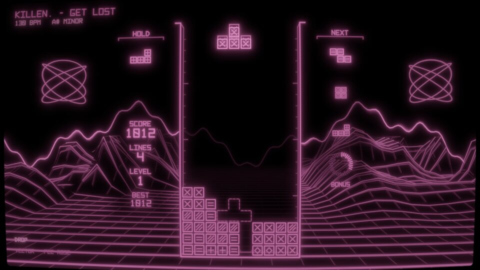

Phosphor beams on a dark CRT. Four phosphors (P1 green, P3 amber, P4 white, P22 rose), from the key. The pieces burn with a white-hot core and a faint lit interior; the world behind (horizon trace, floor grid, mountains) is dimmer, thinner and fades out around the well. Peaks stay calm: low mountains breathing with the spectrum, two faint Lissajous scopes, a soft bloom swell on the drop.

## SUMI

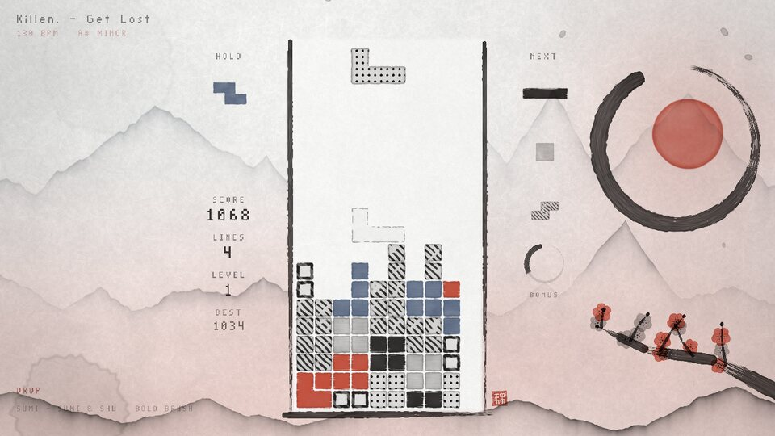

Ink on washi paper. Eight inks (SUMI & SHU, AIZOME & OCHRE, SEPIA & CELADON, MURASAKI & GOLD, MATCHA & RUST, KAKI & CHARCOAL, and two lacquer negatives, URUSHI & SILVER and YORU & GOLD), from the key's hue (night songs sometimes take a negative). Calm is a faint far mountain on white paper, mid brings mist, drifting ranges and a few petals; the peak brushes the ensō around a red sun and paints a plum branch in from the bottom right corner, stroke by stroke, its blossoms (the accent's wash or pale ink) opening behind the brush while petals drift down across the paper on a gentle wind (faint behind the well). A drop waits for its first downbeat to brush the ensō and the branch, blows a flurry of petals off the blossoms that settles to a steady fall, and soaks the lower sky in a wash of color (the accent, or a deeper second ink where the accent is gold), with one swell on the downbeat and a steady level for the whole drop. Slow motion turns the print to its negative.

## DIORAMA

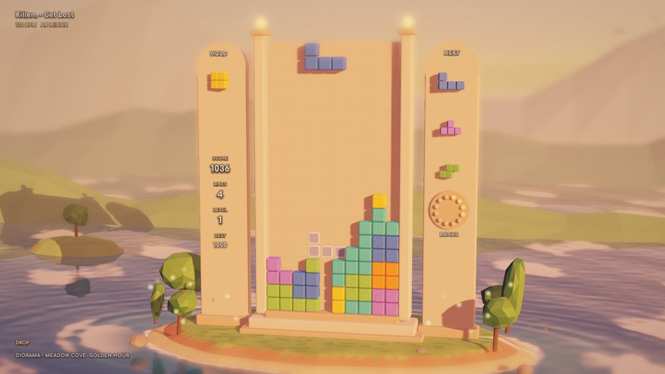

A clay miniature by night, the well a tower on a small island in a still sea, its lanterns lit. Twelve places, from the key and mode (MEADOW COVE, TERRACOTTA MESA, LAVENDER SNOW, PINE AND SEA, AUTUMN MAPLES, MANGO LAGOON, SAKURA STONES, JADE VOLCANO, HEATHER HIGHLANDS under the shared night sky; MOONLIT COVE, LANTERN HARBOR, FIREFLY FJORD with skies of their own); the song's phases move the moon across the sky (moonrise, midnight, starlight, lantern hour), and slow motion brings the day: the place sunlit, its clay pale, the time slowed. Cleared blocks pop off the tower and shrink away as they tumble; a landing pushes one puff of dust out from under the piece. The HUD has no plaques or cards: cream lettering set straight over the scene, each glyph on a feathered dark halo, so it reads on the pale clay by day and on the night sea alike; its font is Comfortaa (SIL Open Font License, `src/universes/diorama/OFL-Comfortaa.txt`).

## PIXEL

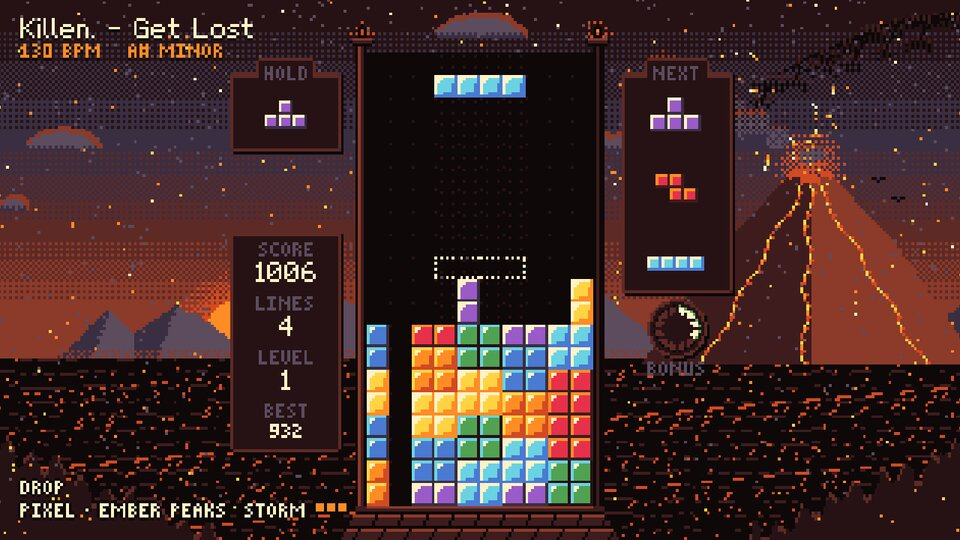

Native low-resolution pixel art, drawn on a small canvas (a well cell is 8 canvas pixels) and scaled up with nearest sampling: sixteen colors per variant, ordered Bayer dithering, parallax ranges, stepped animation. Eight places (PINE DUSK, RED CANYON, SNOW PEAKS, NEON CITY, SEA CLIFFS, CHERRY HILLS, EMBER PEAKS, JADE FALLS), from the key's hue and the mood (`--universe pixel:cherry`). Calm is a still dusk landscape, mid brings nearer layers and critters moving on the beat, peak adds weather (rain and lightning, sand, snow and aurora, petals, ash, leaves) and a foreground that hops by whole pixels. Locks squash, clears explode into pixels, a Tetris fires pixel fireworks across the screen, slow motion swaps to a night palette, and a game over crumbles the stack grain by grain. Its two pixel fonts are drawn by hand in `src/universes/pixel/font.cpp`.

## SYNTHWAVE

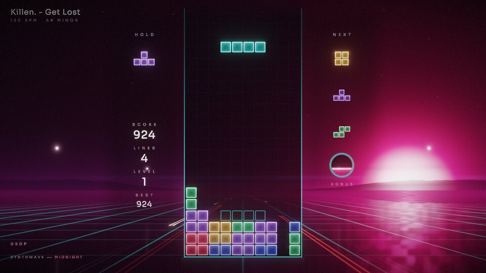

A night drive, shot like a film (Drive, The Midnight): one soft sun (or moon) low on the horizon to one side, deep haze, a wet road that mirrors it in a long broken column, a few fine grid lines running into the fog, street lamps passing, the well a slab of smoked glass with hairline rails. The pieces are frosted glass lit from inside (a soft inner glow, a thin bright rim). Finished like film: bloom with a little halation, anamorphic streaks on the brightest lights, a filmic curve with rich blacks, a fine grain. Eight nights (MIDNIGHT, SODIUM, MOONLIGHT, TAIL LIGHTS in the rain, VIOLET FOG, MINT DAWN, CITY LIGHTS, ROSE DUSK), from the key, mode and brightness. Calm is a quiet empty road (the sun nearly set, thick fog, the floor still), mid drives forward with the tempo (the lines scroll, lamps pass, light pulses run into the fog on the beat), peak is the fast drive (head- and tail-light trails, the haze lit up, flares blooming on the kicks). A cleared row leaves as a light trail toward the sun, a Tetris flares the sun and the lens, slow motion is a time stretch (letterbox, the night drained of color, a timecode), game over turns the lights off row by row while the camera tilts down into the fog; it leaves and enters through the fog. Its HUD font is Sora (SIL Open Font License, `src/universes/synthwave/OFL-Sora.txt`).

## CLOUDSCAPE

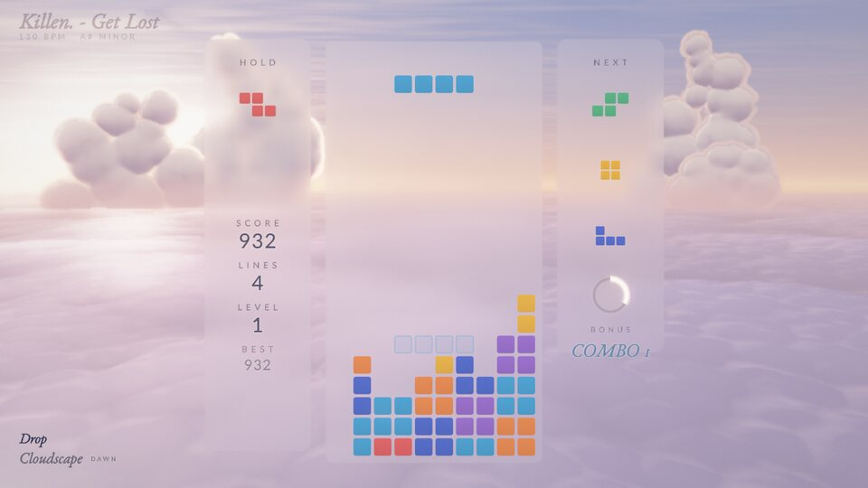

Above an endless sea of clouds, no ground, only sky: a ray-marched sea of cumulus tops fading into the haze, the well and the HUD columns floating panes of frosted glass (only the blur of the sky behind them, no frame), the pieces flat, soft-colored rounded tiles. Eight skies (DAWN, AZURE NOON, GOLDEN HOUR, STORM VIOLET, POLAR NIGHT with aurora, ROSE SUNSET, MONSOON, BLUE HOUR), from the key, mode, brightness and dynamics (`--universe cloudscape:storm`). Calm is a still, hazy sea of clouds, mid drifts the clouds with the tempo (a glide on each beat) while flocks of birds cross the distance flapping on the beat and gentle beams fall from the sun, peak raises the camera while towering cumulus grow out of the sea, god rays stream through their gaps and the kicks light them from inside. A lock breathes a puff of mist, a cleared row dissolves into mist drifting away on the wind, a Tetris parts the high veil and the sun bursts through, slow motion is night above the clouds (the moon, stars, silver cloud tops), game over drops the stack through the sea of clouds as the mist rises; it leaves and enters with the clouds closing in. The sky is drawn at a reduced resolution (at most 540 lines), the rays at a quarter of that. Its HUD fonts are EB Garamond Italic and Lato (SIL Open Font License, `src/universes/cloudscape/OFL-*.txt`).

## ABYSS

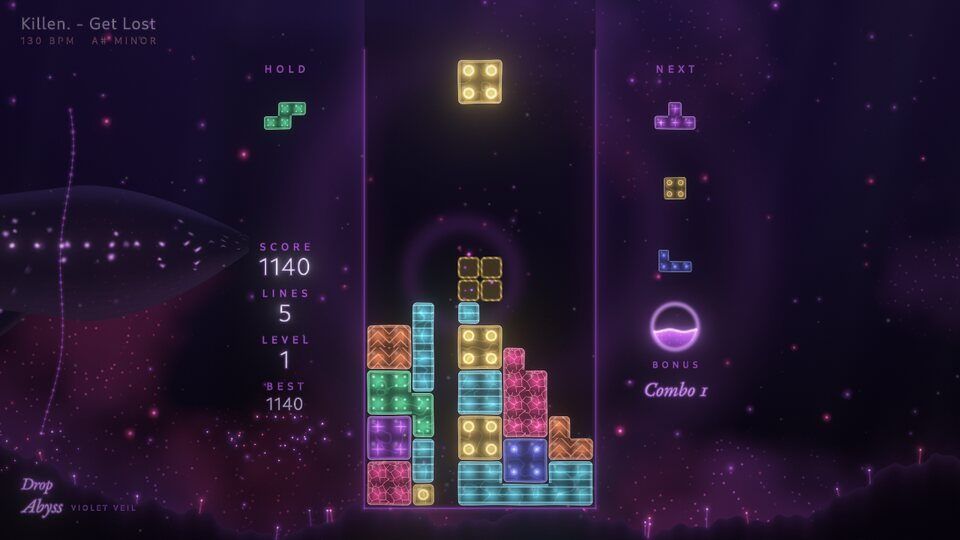

The deep sea, lit only by living things: near-black water with real depth (the far surface a faint glow overhead, slow murk, a dark seabed with glowing worms), sparse marine snow, the well a faint glass column. The pieces are translucent gelatinous blocks lit from within (an inner glow, a bright membrane, caustic veins, and a pattern of their own per piece: filaments, a ring, radial canals, photophores, a cellular net, a nucleus, chevrons); blocks of the same kind merge into one jelly mass. Eight palettes (CYAN LANTERN, VIOLET VEIL, EMERALD TRENCH, EMBER VENT, ICE LIGHT, ULTRAMARINE, CORAL GHOST, MOON JELLY), from the key, mode and brightness. Calm is deep silence (snow, a few distant lights, god rays slanting down from the far surface), mid darkens the water and brings jellyfish and siphonophores pulsing their light on the beat and schools of lanternfish, peak brings a giant whale with bioluminescent spots passing slowly behind the well and the bioluminescence blooming: the water itself lights up in the palette's accent (a milky sea, in slow patches) and plankton lights up densely through it (thinned behind the stack), its brightness pulsing with the kicks while nothing moves faster. A chorus' peak blooms softly; a drop's (the song structure driving harder) floods the water with it, denser and in the accent color, and its first downbeat surges the light at once before it settles over a few seconds. Nothing ever expands across the water (no ring, no shockwave): a lock makes the jelly quiver and stirs a few motes from under it, a cleared row's jelly breaks into points of light drifting up, a Tetris makes the plankton bloom all through the water at once, slow motion puts every light out but the pieces' and an anglerfish's lure, and a game over sinks the stack into the dark, its lights going out one by one; it leaves and enters with the water closing over it. Its HUD fonts are Cantarell Light and EB Garamond Italic (SIL Open Font License, `src/universes/abyss/OFL-*.txt`).

## SMOKE

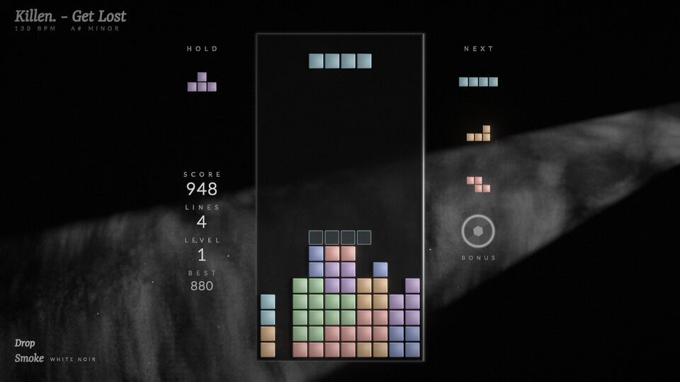

A black stage: one hard spotlight hangs out of frame and cuts a single crisp cone of light through slow, curling smoke (ray-marched through the beam, with the smoke shading itself into shafts), everything else falls into deep black. The well is a slab of smoked black glass standing in the light (a hairline catches the lamp along its edge, it casts its own shadow into the smoke behind), the pieces satin blocks caught in the key light (their edges toward the lamp lit, a soft sheen across the face, a shadow on the glass); dust motes glint where the beam is. Eight lights, each with its own angle and its own seven blocks (TUNGSTEN, DAYLIGHT, RED GEL, TEAL GEL, VIOLET, SODIUM, WHITE NOIR, ROSE), from the key, mode and brightness (`--universe "smoke:red gel"`). Calm is a clean thin shaft in a light haze, mid sets the smoke rolling with the tempo (a slow glide on each beat) and the bass swirling it, peak fills the stage with smoke and opens the iris (a wider, brighter beam, sharp shafts inside it), the kicks surging the smoke. A lock kicks dust of the piece's color up from under it, which shoots up, slows and sags back a little as it fades, a cleared row is crossed by a blade of light and burns off into smoke, a Tetris blows a smoke ring up out of the well and clears the smoke outward as the light opens, slow motion is a cold pin spot straight overhead with the smoke hanging still, game over turns the lamp off (its filament cooling to orange) row by row while the smoke rises over the stack; it leaves and enters with the smoke thickening until it fills the frame. The smoke is drawn at a reduced resolution (at most 400 lines), marched only where the ray crosses the cone. The bonus gauge is a camera iris opening as it fills. Its HUD fonts are Yrsa Light Italic and Lato Light (SIL Open Font License, `src/universes/smoke/OFL-*.txt`).

## WATERCOLOR

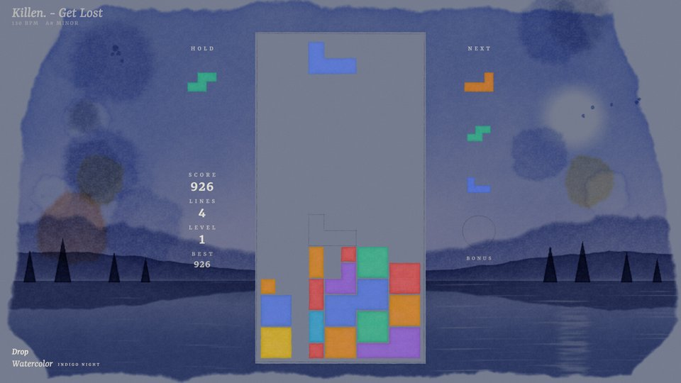

Wet watercolor on cold-press paper. A landscape painted in a few loose, transparent washes and vignetted on the white sheet with ragged edges (a graded wet-in-wet sky with backruns, a far range fading into mist, a crisp middle range with dried darker rims, still water, fields or trees in front); colors are absorbances, so washes glaze over each other and granulate in the paper's tooth. The well is masked-out paper inside a light pencil frame; the pieces are transparent pigment washes (one wash per patch of a color, a hairline of paper between colors), landing wet and drying with a dark rim; the ghost is their pencil underdrawing. Eight paintings with their own pigments, pieces included (TURNER SUNSET, NORDIC FJORD, PROVENCE LAVENDER, MONSOON GREENS, STORM GREY, CHERRY SPRING, AUTUMN EARTH, and INDIGO NIGHT on toned paper with gouache pieces and lettering), from the key, mode, brightness and dynamics. Calm is a quick sketch on a mostly white sheet, mid paints the middle range, the foreground and the trees in and the beats drop pigment that blooms in the wet sky, peak glazes everything deeper up to the top of the sheet and the kicks flick spatter. A cleared row's pigment dissolves back into the paper in a moment (nothing painted over the row, nothing left behind), a Tetris floods the sheet (a great backrun and a fresh glaze), slow motion is a night glaze of indigo with the moon lifted out, game over runs the stack down in drips while the painting is washed back to paper; it leaves by washing the sheet back to plain paper from the well outward. The landscape and the blooms are drawn at a reduced resolution (at most 540 lines). Its HUD font is Yrsa (Italic and Medium, SIL Open Font License, `src/universes/watercolor/OFL-Yrsa.txt`).

## POLAR NIGHT

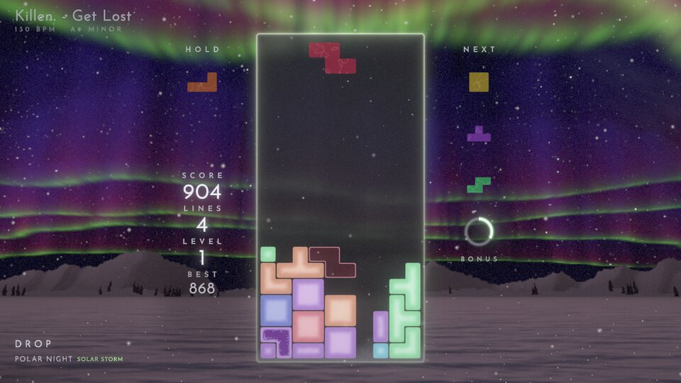

A snowfield under the stars: snowy ranges and a dark treeline on the horizon, a deep starry sky (the Milky Way faint across it) and the aurora, ray-marched as curtains with a bright lower edge, fine rays and a diffuse top; each ribbon follows a group of frequency bands (the far, low one the bass, the nearer, higher ones the highs) and its light falls on the snow and the pieces. The well is a sheet of dark ice with a hairline rim; the pieces are ice cubes that visibly freeze: the falling piece (and the previews) is clear colored water, saturated, the night seen through it; a landed piece freezes over 7 s like a cube in a freezer, frost creeping in from its outside faces (needles of feathery crystals ahead of a frosted band thickening inward) while the body clouds over to a milky core and the color goes pastel, a slight wisp of cold vapor rising off its top while it sets; old ice is a matte frosted cube, whitish but clearly tinted, its core a little whiter. No outline, bevel, gloss or reflection streak: crisp only at the silhouette, so new, freezing and old pieces read apart at a glance. Each piece is one body of ice with no junction between its cells (two pieces never join, a thin seam stays between them; a stack inherited from another universe is grouped into bodies of at most four cells), its frost in its own frame so it travels with it. Eight nights (EMERALD, VIOLET VEIL, CRIMSON, ARCTIC TEAL, MOONLIT, BLUE HOUR, SOLAR STORM, ICE FOG with a 22° moon halo), each with its own seven ices, from the key, mode, brightness, dynamics and density (`--universe polar:crimson`). Calm is a still night (one faint ribbon low on the horizon, a few flakes), mid wakes several curtains folding with the tempo and rippling on the beat while the snow falls, peak fills the sky (curtains overhead, the camera looking up, surges of light running along them on the kicks, blowing snow over the drifts). A lock leaves a tiny sparkle where the piece touched down, then it freezes (above); a cleared row cracks (the cracks running from where the piece landed) and shatters into shards that tumble and fall off the bottom of the screen (a Tetris throws them further), a Tetris is an auroral substorm, slow motion freezes time (the snowflakes hang and glint, the aurora barely moves, the colors drain to silver, frost creeps in at the screen's edges), game over freezes the stack white from the bottom up, then it crumbles while blowing snow buries the field; it leaves and enters through a whiteout of blowing snow. The world is drawn at a reduced resolution (at most 540 lines). Its HUD font is Josefin Sans (SIL Open Font License, `src/universes/polar/OFL-JosefinSans.txt`).

## RISOGRAPH

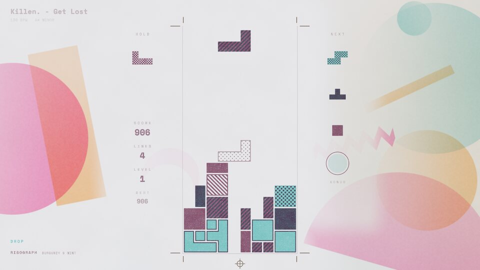

A risograph print: the whole frame is two spot inks on a paper stock, a third ink joining at the peaks. The pieces and the marks are laid by the drums as flat shapes and halftone tints (dots at a fixed angle per drum, or a line screen), overprints darkening where two inks cross, a riso grain in the ink; the background is soft, a riso gradient print: big flat shapes and broad gradients of ink density on the paper, with a fine, almost invisible grain and no visible screen, kept off the well and the text's side so that the HUD reads cleanly. Only the background's drums are slightly out of register (drifting slowly); the stack, the pieces and the HUD are always printed in register. Lots of paper, little else: each variant has its own neutral stock (a cool white, light grey, pale blue, pink or mint, two blacks; never cream) with a faint tone and tooth; the world is one big gradient disc fading toward the well and, at the peaks, the third ink's shape overprinting it. The well is marked by crop marks and a registration target, with hairline trims; the pieces are flat ink shapes, each type its own recipe (a solid ink, the overprint of both, a solid with the other ink's dots, a hatched tint with a keyline...), so the seven types read by color and pattern; the cells of one piece print as one clean shape, two pieces always keep a hairline of paper between them; the ghost is a keyline and a light tint. Eight ink sets, each with its own pieces through its inks (FLUO PINK & BLUE, TEAL & YELLOW, RED & FEDERAL BLUE, BLACK & FLUO PINK, VIOLET & GREEN, BURGUNDY & MINT, and on black paper, where the inks lie like light, YELLOW & PURPLE and AQUA & ORANGE), from the key, mode, brightness and dynamics (`--universe "risograph:teal & yellow"`). Calm is a still print, a single pale gradient disc on the paper; mid deepens the disc and the second ink's gradient across the sheet and prints a half sun of the second ink rising from the bottom edge, the shapes floating very slowly; peak brings the third ink's shape, a broad bloom of the third ink from the shapes' edge of the sheet and a new layer of cut-paper forms in a fourth, hot fluorescent ink of the variant (fluo orange, pink or yellow): a big circle and a tall block of the third ink on the free side of the sheet (between the title and the bottom lines, clear of the score), while the half sun turns to the hot ink, all overprinting each other. On the drop they ink in one after the other within a third of a second, growing a little as they ink, stay for the whole peak and lift slowly after it; the kicks breathe the inks' density (about 0.2 s in, 0.5 s out) and swell the forms by a few percent, smoothly. The background print moves on a slow current, like paper cut-outs floating: still at calm, a slow drift at mid (the half sun and the world's discs wander and turn a little), clearly moving at the peak, the drop gathering pace over its first second and settling over a few (the speed is eased twice, so nothing ever changes speed abruptly). At the peak the big forms wander around their places, each at its own pace and heading, the block and the half sun turning, the gradient across the circle turning; smaller printed forms glide across the sheet, entering from one edge and leaving by the other at a few board units a second (a strip of the third ink along the upper sheet, a crescent of the hot ink across the lower sheet, a small disc rising on the shapes' side, a zigzag ribbon through the middle), turning slowly and overprinting the big forms and each other as they cross. Forms crossing the well and the HUD's columns print there only faintly (nearly not at all for the gliders), so the stack stays on clean paper. Two other drop treatments were tried (a huge sun of the third ink behind the well with a hot horizon band; the hot ink flooding in from both edges with concentric arcs behind the well) and set aside for the cut paper. The stack, the falling piece, the previews and the HUD never move; the background moves only smoothly and continuously (no jumps, no re-composing on beats, no shake). A lock presses a small soft blot of the second ink out under the piece, a cleared row is torn off as a strip (ragged edges, its dots shrinking away in under half a second), a Tetris stamps the third ink in one huge soft disc over the sheet, slow motion is a monotone print (one ink, the drums locked in register), game over runs the drum dry (the stack fading in vertical streaks); it leaves and enters with the ink lifting off the paper, the stack left plain. The bonus gauge is a keyline circle filling with a deepening tint. Its HUD font is Space Mono (SIL Open Font License, `src/universes/risograph/OFL-SpaceMono.txt`).

## Transitions between universes

A new song comes in with its universe through a transition, started on the next downbeat (or the next beat when
the bar is far) and lasting 1 to 4 bars (about 4 s at the song's tempo). Both universes render during it (each
gets every game event and phase change, so locks and line clears look right in both halves, and persistent
buffers such as VECTOR's phosphor keep running); outside transitions only one renders. Since every universe puts
the well at the same pixels (the layout contract), the stack stays where it is and only its material and its world
change. The transitions, universe-agnostic and driven only by data each universe declares once (its hints):

- **REBUILD**: the stack re-materializes row by row from the bottom under a scan beam, then the world follows,
  outward from the well.
- **RIPPLE**: a refracting ring leaves the well's outline, with an echo ring a beat behind. Never picked at random (it read as a shockwave on the drop); only with `--transition ripple`.
- **INK**: an organic dissolve spreading from the well, with fibrous edges (inked toward a light universe,
  glowing toward a dark one).
- **CURTAIN**: the old universe opens like curtains from the well's axis, gathered in folds at the edges.
- **LUMA**: darks switch first, highlights last.
- **TILES**: the screen in cells of the well's size, aligned with it, flipping like cards: the well from the
  bottom up, then the cells around it, on the eighth notes.

The pick favours the styles both universes declare, transitions that bridge brightness gracefully between a
dark and a light universe, and never repeats the last one. Between a dark and a light universe the blend goes
through the lighter (or darker) of the two instead of gray, and the front glows (toward a dark universe) or is
inked (toward a light one). In the middle of a change both universes go to the **bridge**: their world fades,
the stack turns plain, in their own tones; so the two halves meet in a neutral state whatever the pair.

## Roadmap

The list below is the roadmap, in implementation order. After the universes already built, ideas are ranked by how
well they fit what play testing showed works: minimalist worlds with one strong, original idea first (the family of
WATERCOLOR, SUMI, VECTOR and SMOKE), then ideas that need restraint to avoid clutter, and last the busy, kitsch or
classical ones (a retro handheld or arcade look is too close to an ordinary Tetris). Universes marked ✅ exist, the
others are ideas waiting to be built. To build one, see [Adding a universe](adding-a-universe.md).

| # | Universe | Look | How the music plays it | Status |
|---|---|---|---|---|
| 1 | SUMI | Ink on washi paper, sumi black + one vermilion seal; brushed pieces told apart by ink treatment | Beats diffuse ink in the paper; calm = faint far mountain, peak = ensō brush circle, red sun, a plum branch painted in and falling petals; a drop colors the sky | ✅ |
| 2 | VECTOR | Phosphor beams on black CRT glass, one phosphor per song, persistence trails; pieces are line glyphs | Calm = a lone oscilloscope trace; mid = scrolling vector grid; peak = low spectrum mountains and faint Lissajous scopes, breathing on the beat (no flash, no shake); clears shatter into vector debris | ✅ |
| 3 | DIORAMA | Clay miniature by night: the board on a floating island, soft shadows, tilt-shift | Phases move the moon across the sky; kicks ripple the water; cleared blocks tumble into the sea; slow motion is a sunlit day | ✅ |
| 4 | PIXEL | Native 320×180 pixel art, 16-color palette, Bayer dithering, parallax layers | Sprites animate on the beat; peak adds parallax layers and weather; clears are pixel explosions | ✅ |
| 5 | SYNTHWAVE | Cinematic night drive: a soft low sun in the haze, a wet road, fine lines into the fog, frosted glass pieces | The road moves with the tempo; light pulses on the beat; peak = light trails and anamorphic flares on the kicks | ✅ |
| 6 | CLOUDSCAPE | Above the clouds, volumetric light, endless sky | Calm = still dawn sea of clouds; peak = towering cumulus and sun rays; clears drift away as mist | ✅ |
| 7 | ABYSS | Deep-sea darkness, bioluminescent jelly pieces, marine snow | Creatures pulse their light with the beat; peak brings a giant glowing whale passing by; clears break into points of light |✅ |
| 8 | POLAR NIGHT | Snowfield under the stars, aurora ribbons, water pieces freezing into ice cubes | Aurora ribbons follow the frequency bands; peak fills the sky; pieces freeze on lock, clears shatter; slow motion freezes the falling snow | ✅ |
| 9 | WATERCOLOR | A landscape in transparent washes on cold-press paper: granulation, blooms, dried rims; pigment-wash pieces, pencil ghost | Beats drop pigment into wet washes; peak adds saturated glazes; clears dissolve back into the paper | ✅ |
| 10 | SMOKE | Volumetric smoke and one hard spotlight on a black stage; satin blocks caught in the key light | The smoke swirls with the bass; peak = more light cuts through; a Tetris blows a smoke ring | ✅ |
| 11 | WHITE ROOM | Pure white space, soft shadows only, product-design minimalism | Shadows lengthen with the phases; beats press the blocks gently | |
| 12 | RISOGRAPH | Two-ink riso print (fluo pink + blue), soft ink gradients, halftone pieces | Kicks breathe the inks' density; peak prints cut-paper forms in a hot fourth ink; clears are torn-off strips | ✅ |
| 13 | KINTSUGI | Black marble, gold-filled cracks | Cleared rows crack and fall away; gold veins spread through the marble at peak | |
| 14 | LASER SHOW | Volumetric laser beams in haze, a few at a time | Beams pivot slowly with the bands; drops open full laser fans; cleared cells burn out | |
| 15 | OP ART | Black and white Bridget Riley stripes and moirés, calm and never flickering | The stripe field bends around the stack; beats ripple it gently; peak makes the whole field undulate | |
| 16 | SHADOW PLAY | Silhouettes behind a backlit paper screen, warm lamp | Puppets dance on the beat; the lamp flickers; peak brings more puppets | |
| 17 | BLUEPRINT | Cyanotype technical drawing, white construction lines, dimension marks | Locks get dimensioned; mid draws an elevation of a machine; peak animates it; cleared cells fade like lifted ink | |
| 18 | LANTERNS | Paper lanterns floating on a dark lake | Each clear releases lanterns; peak fills the sky; beats ripple the reflections | |
| 19 | TOPOGRAPHY | Contour-line map, elevation shading | The terrain's elevation follows the spectrum; peak raises mountains; clears are eroded by rivers | |
| 20 | ORIGAMI | Folded paper pieces with crease shading, soft paper light | Pieces unfold on lock; cleared rows fold into paper cranes that fly off; peak fills the sky with cranes | |
| 21 | ZEN GARDEN | Raked sand seen from above, stones, moss | Rake lines ripple from the stones on beats; cleared blocks sink into the sand | |
| 22 | SWISS POSTER | International typographic style: huge words from the song title, strict grid | Words recompose on bars; beats shift the grid; peak sets the title giant | |
| 23 | X-RAY | Radiograph: glowing bones of the blocks on dark blue | Beats pulse like a heartbeat monitor; clears fade out like an exposure | |
| 24 | LIMBO | Monochrome silhouettes in fog | Fog thickens and opens with the phases; distant shapes move on beats | |
| 25 | BAUHAUS | Flat primaries, circles, triangles and squares in a strict composition | The composition recomposes on each bar; peak rotates the big forms; clears slide out as flat shapes | |
| 26 | DE STIJL | Mondrian grid: the stack itself becomes a composition | New grid lines are drawn on bars; peak reorganizes the color blocks | |
| 27 | BRUTALIST | Raw concrete, hard sunlight, deep geometric shadows | Shadows move with the sun across the phases; beats are dust in the light shafts | |
| 28 | THERMAL | Heat camera palette: locked pieces are hot and cool down | The stack's heat follows the energy; peak = everything glows hot | |
| 29 | STAR CHART | Antique engraved celestial map, gold on navy | Constellations are drawn on bars; peak animates the zodiac figures | |
| 30 | SONAR | A dark sea where shapes surface from the black, no sweeping beam | Shapes glow up from the dark on beats; peak reveals a sunken city; cleared cells sink into the dark | |
| 31 | KANDINSKY | Abstract musical painting: one shape family per instrument band | Bass, mids and highs paint circles, lines and dots; peak fills the canvas | |
| 32 | CRYSTAL CAVE | Geodes, refracting crystals, dripping water | Crystals ring and glow with the highs; peak lights the whole cave | |
| 33 | GLOWING FOREST | Night forest of bioluminescent mushrooms and plants | Plants pulse with the bass; peak = a wave of light across the forest | |
| 34 | ORBIT | A space station window, Earth slowly turning below | Calm = night side and city lights; peak = sunrise over the limb; clears float away weightless | |
| 35 | MIRAGE | Desert dunes, heat haze, white sun | Haze shimmers with the highs; drops raise a sandstorm; clears blow away as sand | |
| 36 | TRANSIT MAP | Vignelli subway map: colored lines and stations | New lines are drawn on bars; trains (dots) run with the beat | |
| 37 | UKIYO-E | Colored woodblock print, Prussian blue, a great wave, wood grain in the inks | The wave grows with energy and breaks on drops; clears are wiped by foam | |
| 38 | NOIR | High-contrast black and white, venetian blind shadows, rain and smoke | The blinds' shadows sway on beats; peak = lightning; clears dissolve into smoke | |
| 39 | MANGA | Black and white screentones, ink speed lines | Drops add dramatic focus lines; cleared cells crumble into screentone dots | |
| 40 | STAINED GLASS | Cathedral window: lead between cells, colored light shafts on stone | The sun moves behind the window through the phases; beats glint the glass; clears crack and fall as shards | |
| 41 | BLACK-FIGURE | Ancient Greek vase painting, terracotta and black | Figures run around the vase at tempo; clears crack the pottery | |
| 42 | GIRIH | Islamic geometric star patterns, tiles unfolding | The pattern unfolds from the center with the energy; peak = full star field | |
| 43 | AZULEJO | Blue and white glazed tiles, cracks, glaze sheen | Tile patterns rotate on bars; peak adds a figurative panel | |
| 44 | MOSAIC | Roman tesserae, grout lines, slight irregularity | A mosaic picture reveals itself as lines are cleared; peak shines the gold tesserae | |
| 45 | FORGE | Molten metal, a blacksmith's anvil, cooling steel | Pieces glow orange and darken as they cool; kicks are hammer blows with sparks | |
| 46 | TYPEWRITER | Typed paper, ribbon ink, carriage | Pieces are typed glyphs; the carriage returns on bars; clears are crossed out with x's | |
| 47 | CHALKBOARD | Chalk on slate, smudges, dusty light | Equations and diagrams scribbled to the beat; clears erased by a sponge leaving wet streaks | |
| 48 | NOTEBOOK | Ballpoint doodles on graph paper, highlighter accents, coffee stain | Doodles grow in the margins with the song; beats wiggle the lines (boiling line); clears are scribbled out | |
| 49 | SOAP BUBBLES | Thin-film iridescence on a soft backdrop | Bubbles drift and pop on beats; clears burst into droplets | |
| 50 | BLACKLIGHT | Fluorescent paint glowing in UV darkness | Paint splashes on kicks; peak = everything fluoresces | |
| 51 | RAINY WINDOW | Droplets on a window, a blurred city behind (bokeh) | Drops run down on beats; peak = downpour; the city lights pulse with the bass | |
| 52 | SHORELINE | Beach from above: waves washing sand, foam | Waves come in on bars; drops = big wave; clears are washed off by the foam | |
| 53 | MICROSCOPE | Petri dish under a microscope, cells, stained colors | Cells divide on beats; peak brings a bloom of organisms; clears are absorbed by a cell | |
| 54 | CIRCUIT | PCB green, copper traces, chips | Signals run along the traces on beats; peak lights the whole board; clears blow fuses | |
| 55 | MOEBIUS | Clean-line French comic, flat colors, desert planets and giant birds | Calm = still vistas, peak = flying creatures crossing; clears are inked away | |
| 56 | IMPRESSIONIST | Monet-like visible brush strokes, water lilies, dappled light | The brush strokes shimmer with the highs; phases move the light across the pond | |
| 57 | CAMPFIRE | Night forest clearing, fire light on trees, sparks | The fire breathes with the bass; sparks rise on kicks; peak = a big blaze, clears turn to embers | |
| 58 | FIREWORKS | Harbor at night, reflections | Fireworks launch on kicks; peak = the finale | |
| 59 | AUTUMN PARK | Falling leaves, low warm sun, puddles | Leaves fall with the beat; gusts on drops; clears are swept up as leaves | |
| 60 | ART DECO | Gold lines on black lacquer, fans and sunbursts, strict symmetry | Gold sunburst rays open with energy; beats glint the gold; clears slide away as gold leaf | |
| 61 | KILIM | Woven rug geometry, natural dyes | Patterns are woven row by row; beats shift the weave | |
| 62 | HERBARIUM | Scientific botanical plates, labels, pressed flowers | Specimens are drawn and labelled as the song advances | |
| 63 | MANUSCRIPT | Medieval vellum, gold leaf, illuminated drop caps | Ornaments are drawn with the song's progress; gold catches the light on beats | |
| 64 | FELT | Stop-motion felt and wool, stitches, 12 fps motion | Everything boils slightly; beats squash the felt; clears are cut out with scissors | |
| 65 | CARDBOARD | Cardboard cut-outs, tape, craft knife edges | The set pieces wobble on their stands with the beat; peak adds more layers of cardboard scenery | |
| 66 | KNIT | Wool knit stitches, yarn texture, warm light | Rows are knitted in; clears unravel into loose yarn | |
| 67 | EMBROIDERY | Cross-stitch on linen, thread sheen, hoop frame | The design is stitched across the song; beats tug the threads | |
| 68 | TERRARIUM | A glass jar ecosystem, moss, condensation | Fog and condensation follow the phases; a beetle wanders; peak = fireflies | |
| 69 | ORRERY | A brass planetarium machine, planets on arms | Planets orbit at tempo fractions; peak opens the whole machine | |
| 70 | SNOW GLOBE | The board inside a snow globe on a shelf | Drops shake the globe; snow settles in calm parts | |
| 71 | GREENHOUSE | Victorian glasshouse, plants, warm humid light | Plants grow and unfold with the song's progress; peak opens flowers; rain on the glass in calm parts | |
| 72 | MUSIC BOX | A wooden music box, brass comb, rotating pinned cylinder | The cylinder turns at the tempo; locks pluck the comb; the dancer spins at peak | |
| 73 | TOMB | Hieroglyph wall, gold and lapis, torchlight | Torches flicker on beats; peak reveals gold hieroglyphs | |
| 74 | VOXEL VALLEY | Voxel landscape with rivers and trees | Seasons follow the phases (spring → summer → autumn); the voxel water ripples on kicks | |
| 75 | CORAL REEF | Sunny shallows, caustics, colorful reef | Fish schools follow the melody; kicks pulse the caustics; clears burst into bubbles | |
| 76 | ANIME SKY | Makoto Shinkai skies, painted clouds, lens flares | Clouds race with energy; peak = golden hour; Tetris = a meteor across the sky | |
| 77 | MEMPHIS | 80s Memphis design: squiggles, terrazzo, pastels with black outlines | Squiggles bounce on beats; peak spawns more shapes and pattern swaps | |
| 78 | ART NOUVEAU | Mucha arabesques, organic frames, floral ornaments | Vines grow around the board with the song; peak blooms the ornaments | |
| 79 | JAZZ CLUB | Velvet, brass, a smoky single spotlight | The spotlight breathes with the music; peak opens the stage lights | |
| 80 | TRAIN WINDOW | Landscape rushing past a train window | The landscape's speed follows the tempo; tunnels on drops; calm = countryside at dusk | |
| 81 | SUPER 8 | Faded home movie, warm light leaks, gate weave | Light leaks flare on kicks; peak = sunny summer footage | |
| 82 | HOLOGRAM | Sci-fi holographic UI, cyan scanlines, depth layers | Hologram jitter on kicks; peak opens extra panels around the board | |
| 83 | WET NEON STREET | Rainy Tokyo alley at night, reflections on wet asphalt, signs | Signs flicker on beats, rain thickens with energy, a train passes on drops | |
| 84 | NIGHT DRIVE | Highway at night, headlights, lane markers | Lane markers flash past on beats; peak = city lights and tunnels | |
| 85 | LO-FI ROOM | Cozy bedroom at night, desk lamp, the city through the window | The cat's tail and the plant sway on the beat; peak lights the city; slow motion = a sleepy, blurred room | |
| 86 | DATAMOSH | Compression artifacts, pixel sorting, glitch blocks | Glitches only on strong hits; drops pixel-sort the screen; clears datamosh away | |
| 87 | SILENT FILM | Sepia, grain, scratches, iris transitions | Frame rate stutters gently with the tempo; phase changes are iris wipes and intertitles | |
| 88 | COMIC | Ben-Day dots, panels, speed lines | Clears shout onomatopoeias (POW, BAM); peak splits the screen into panels | |
| 89 | VAPORWAVE | Marble busts, 90s desktop windows, pink and teal | Windows pop up on bars; peak = slowed, chorused visuals with a sunset | |
| 90 | Y2K CHROME | Liquid chrome, iridescent bubbles, blobby type | Chrome blobs melt and reform on beats; peak = full liquid metal | |
| 91 | DISCO | Mirror ball, light dots, a lit dance floor | Floor tiles light up on beats; the mirror ball speeds up at peak | |
| 92 | TOY ROOM | Plastic bricks with studs, a child's room floor, tilt-shift | Bricks click into place on locks; peak brings toy trains and spinning tops; clears scatter bricks | |
| 93 | CANDY SHOP | Glossy candy and gummy pieces, sugar crystals, pastel kitchen | Pieces wobble like jelly on beats; clears burst into sprinkles | |
| 94 | CLOCKWORK | Brass gears and springs, steampunk | Gears tick on beats; peak spins the mechanism; clears pop springs | |
| 95 | BAROQUE CEILING | Trompe-l'œil fresco sky, clouds and gilded frames | The painted sky opens with energy; light rays at peak | |
| 96 | PUPPET THEATER | A small stage, velvet curtains, spotlights | Phases are acts; spotlights follow the active piece; Tetris gets a curtain call | |
| 97 | PINBALL | A pinball playfield, bumpers, lights, chrome | Bumpers flash on beats; Tetris = multiball and jackpot lights | |
| 98 | ARCADE CABINET | The game seen inside a cabinet in a dark arcade, bezel art, CRT glare | Neighboring cabinets light up with the music; peak = the arcade's neon wakes up | |
| 99 | TERMINAL | Text mode: everything is characters on an 80×25 grid, ANSI colors | Characters cascade on beats; peak floods the screen with scrolling logs; clears are typed away | |
| 100 | POCKET LCD | 4-shade green handheld LCD, visible pixel grid, ghosting | Peak uses the screen's full contrast and LCD smearing; the bonus fades the screen as if the batteries were low | |
