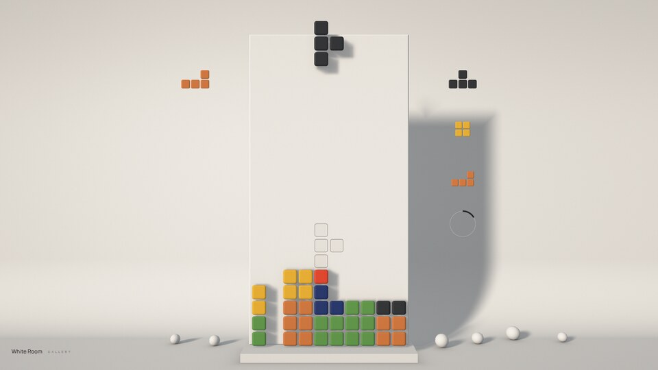
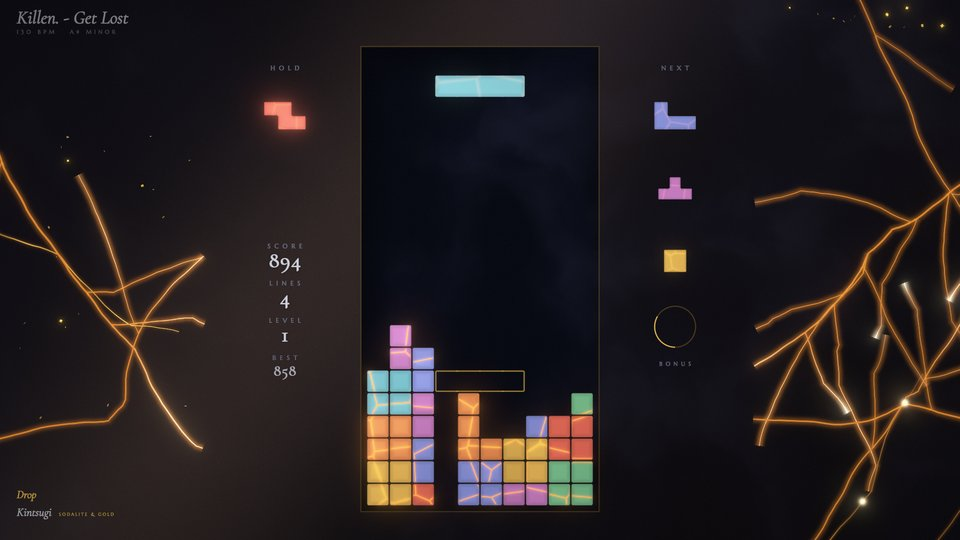
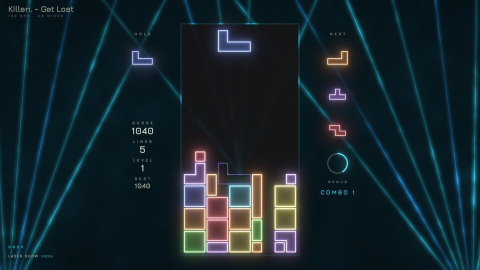
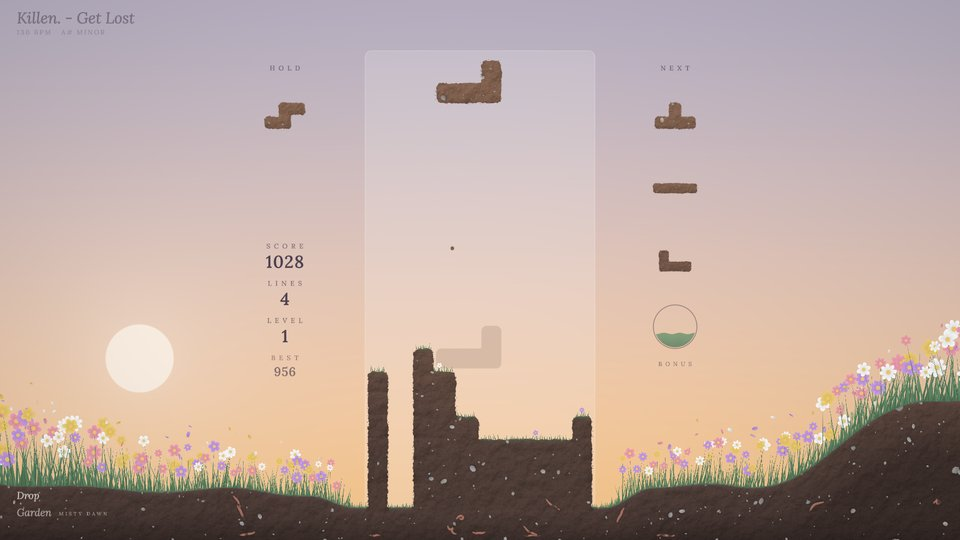
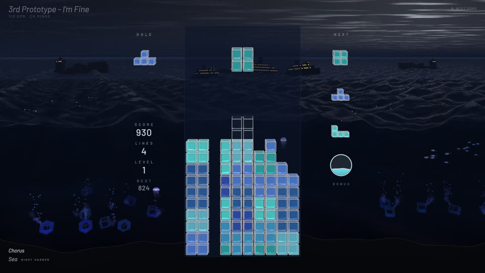
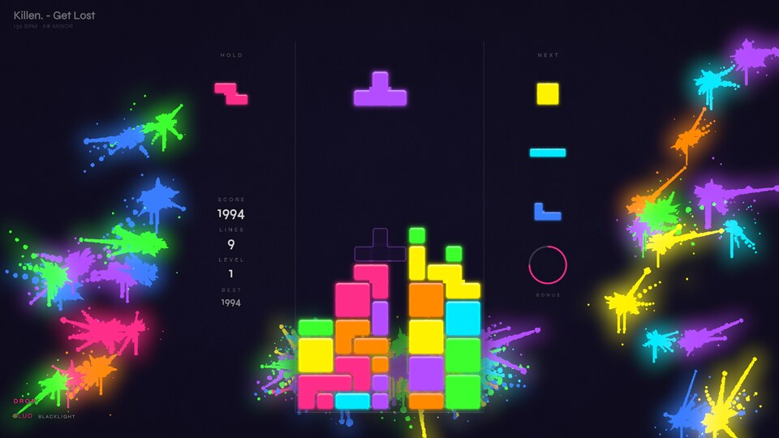
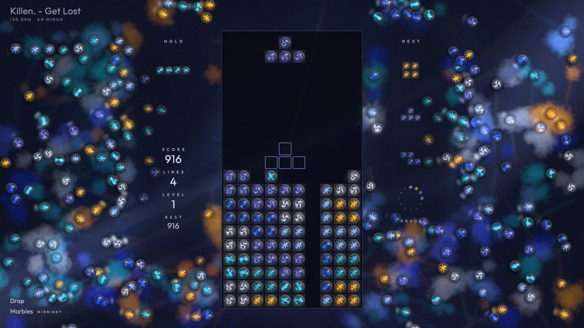
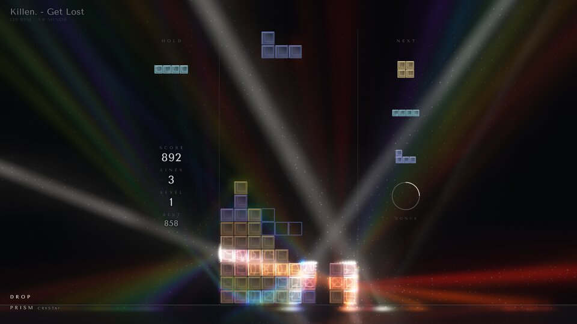
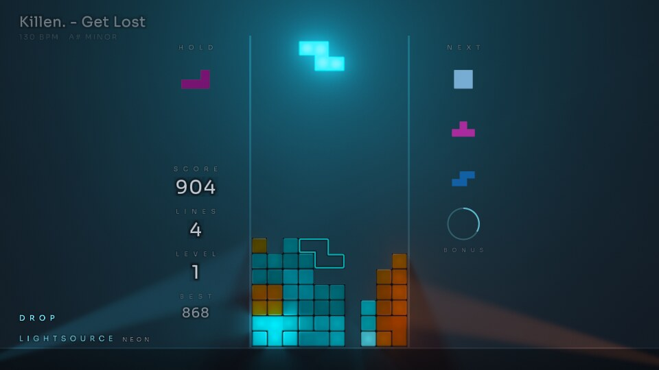
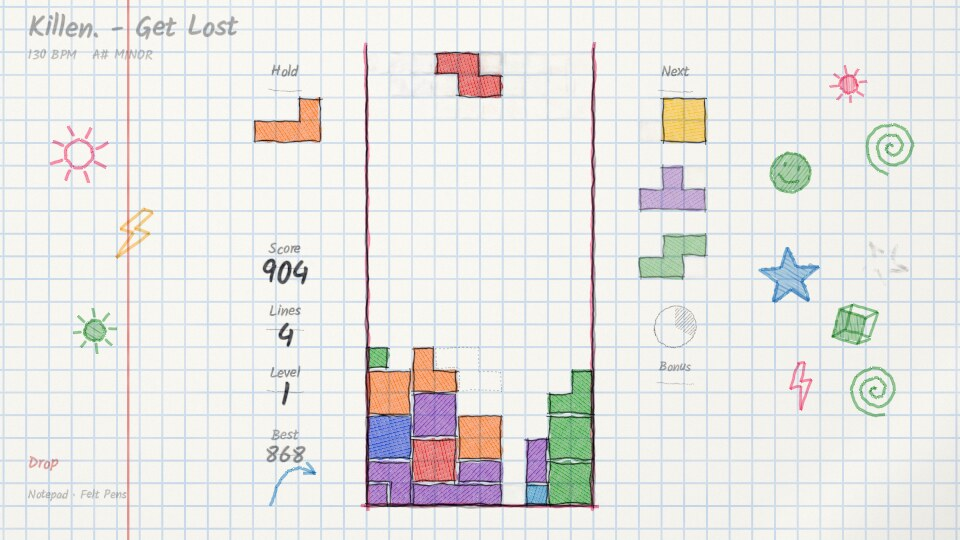

# Universes

Each song is played in a **universe**: a complete, hand-directed art direction with its own world, palette,
materials, HUD style and its own way of staging the music (beats, kicks, calm / mid / peak levels, line clears,
Tetris, slow motion, game over). A universe is one world, not a set of random options. The song chooses
the intensity inside that world, never a different world.

A universe is picked for each song from its footprint (each universe says how well it suits a song: tempo,
brightness, density...) and the run's seed, never the same one twice in a row; `--universe` forces one, T / Y
moves on to the next. Every universe ships a few curated **variants**, picked per song or forced
(`--universe VECTOR:AMBER`, `--universe SUMI:AIZOME`); the bottom-left corner shows `UNIVERSE · VARIANT`.

## VECTOR

Phosphor beams on a dark CRT. Four phosphors (P1 green, P3 amber, P4 white, P22 rose), from the key. The pieces burn with a white-hot core and a faint lit interior; the world behind (horizon trace, floor grid, mountains) is dimmer, thinner and fades out around the well. Peaks stay calm: low mountains breathing with the spectrum, two faint Lissajous scopes, a soft bloom swell on the drop. A drop retunes the tube to another phosphor for its whole length (green and rose turn amber, amber and white turn rose), back to the song's own when it ends.

## SUMI

Ink on washi paper. Eight inks (SUMI & SHU, AIZOME & OCHRE, SEPIA & CELADON, MURASAKI & GOLD, MATCHA & RUST, KAKI & CHARCOAL, and two lacquer negatives, URUSHI & SILVER and YORU & GOLD), from the key's hue (half of the night songs and about one song in five take a negative). Calm is a faint far mountain on white paper, mid brings mist, drifting ranges and a few petals; the peak brushes the ensō around a red sun and paints a plum branch in from the bottom right corner, stroke by stroke, its blossoms (the accent's wash or pale ink) opening behind the brush while petals drift down across the paper on a gentle wind (faint behind the well). A drop waits for its first downbeat to brush the ensō and the branch, blows a flurry of petals off the blossoms and hurls them all down very fast on a gust that dies down over a few seconds (the petals visibly slowing to the drop's steady fall, denser than a chorus'), and soaks the lower sky in a wash of color (the accent, or a deeper second ink where the accent is gold), with one swell on the downbeat and a steady level for the whole drop. Slow motion turns the print to its negative.

## DIORAMA

A clay miniature by night, the well a tower on a small island in a still sea, its lanterns lit. Twelve places, from the key and mode (MEADOW COVE, TERRACOTTA MESA, LAVENDER SNOW, PINE AND SEA, AUTUMN MAPLES, MANGO LAGOON, SAKURA STONES, JADE VOLCANO, HEATHER HIGHLANDS under the shared night sky; MOONLIT COVE, LANTERN HARBOR, FIREFLY FJORD with skies of their own); the song's phases move the moon across the sky (moonrise, midnight, starlight, lantern hour), a drop turns the night to a golden evening for its whole length (a low warm sun, back to night when it ends), and slow motion brings the day: the place sunlit, its clay pale, the time slowed. Cleared blocks pop off the tower and shrink away as they tumble; a landing pushes one puff of dust out from under the piece. The HUD has no plaques or cards: cream lettering set straight over the scene, each glyph on a feathered dark halo, so it reads on the pale clay by day and on the night sea alike; its font is Comfortaa (SIL Open Font License, `src/universes/diorama/OFL-Comfortaa.txt`).

## PIXEL

Native low-resolution pixel art, drawn on a small canvas (a well cell is 8 canvas pixels) and scaled up with nearest sampling: sixteen colors per variant, ordered Bayer dithering, parallax ranges, stepped animation. Eight places (PINE DUSK, RED CANYON, SNOW PEAKS, NEON CITY, SEA CLIFFS, CHERRY HILLS, EMBER PEAKS, JADE FALLS), from the key's hue and the mood (`--universe pixel:cherry`). Calm is a still dusk landscape, mid brings nearer layers and critters moving on the beat, peak adds weather (rain and lightning, sand, snow and aurora, petals, ash, leaves) and a foreground that hops by whole pixels. Locks squash, clears explode into pixels, a Tetris fires pixel fireworks across the screen, slow motion swaps to a night palette, and a game over crumbles the stack grain by grain. Its two pixel fonts are drawn by hand in `src/universes/pixel/font.cpp`.

## SYNTHWAVE

A night drive, shot like a film (Drive, The Midnight): one soft sun (or moon) low on the horizon to one side, deep haze, a wet road that mirrors it in a long broken column, a few fine grid lines running into the fog, street lamps passing, the well a slab of smoked glass with hairline rails. The pieces are frosted glass lit from inside (a soft inner glow, a thin bright rim). Finished like film: bloom with a little halation, anamorphic streaks on the brightest lights, a filmic curve with rich blacks, a fine grain. Eight nights (MIDNIGHT, SODIUM, MOONLIGHT, TAIL LIGHTS in the rain, VIOLET FOG, MINT DAWN, CITY LIGHTS, ROSE DUSK), from the key, mode and brightness. Calm is a quiet empty road (the sun nearly set, thick fog, the floor still), mid drives forward with the tempo (the lines scroll, lamps pass, light pulses run into the fog on the beat), peak is the fast drive (head- and tail-light trails, the haze lit up, flares blooming on the kicks). A cleared row leaves as a light trail toward the sun, a Tetris flares the sun and the lens, slow motion is a time stretch (letterbox, the night drained of color, a timecode), game over turns the lights off row by row while the camera tilts down into the fog; it leaves and enters through the fog. Its HUD font is Sora (SIL Open Font License, `src/universes/synthwave/OFL-Sora.txt`).

## CLOUDSCAPE

Above an endless sea of clouds, no ground, only sky: a ray-marched sea of cumulus tops fading into the haze, the well and the HUD columns floating panes of frosted glass (only the blur of the sky behind them, no frame), the pieces flat, soft-colored rounded tiles. Eight skies (DAWN, AZURE NOON, GOLDEN HOUR, STORM VIOLET, POLAR NIGHT with aurora, ROSE SUNSET, MONSOON, BLUE HOUR), from the key, mode, brightness and dynamics (`--universe cloudscape:storm`). Calm is a still, hazy sea of clouds, mid drifts the clouds with the tempo (a glide on each beat) while flocks of birds cross the distance flapping on the beat and gentle beams fall from the sun, peak raises the camera while towering cumulus grow out of the sea, god rays stream through their gaps and the kicks light them from inside. A lock breathes a puff of mist, a cleared row dissolves into mist drifting away on the wind, a Tetris parts the high veil and the sun bursts through, slow motion is night above the clouds (the moon, stars, silver cloud tops), game over drops the stack through the sea of clouds as the mist rises; it leaves and enters with the clouds closing in. The sky is drawn at a reduced resolution (at most 540 lines), the rays at a quarter of that. Its HUD fonts are EB Garamond Italic and Lato (SIL Open Font License, `src/universes/cloudscape/OFL-*.txt`).

## ABYSS

The deep sea, lit only by living things: near-black water with real depth (the far surface a faint glow overhead, slow murk, a dark seabed with glowing worms), sparse marine snow, the well a faint glass column. The pieces are translucent gelatinous blocks lit from within (an inner glow, a bright membrane, caustic veins, and a pattern of their own per piece: filaments, a ring, radial canals, photophores, a cellular net, a nucleus, chevrons); blocks of the same kind merge into one jelly mass. Eight palettes (CYAN LANTERN, VIOLET VEIL, EMERALD TRENCH, EMBER VENT, ICE LIGHT, ULTRAMARINE, CORAL GHOST, MOON JELLY), from the key, mode and brightness. Calm is deep silence (snow, a few distant lights, god rays slanting down from the far surface), mid darkens the water and brings jellyfish and siphonophores pulsing their light on the beat and schools of lanternfish, peak brings a giant whale with bioluminescent spots passing slowly behind the well and the bioluminescence blooming: the water itself lights up in the palette's accent (a milky sea, in slow patches) and plankton lights up densely through it (thinned behind the stack), its brightness pulsing with the kicks while nothing moves faster. A chorus' peak blooms softly; a drop's (the song structure driving harder) floods the water with it, denser and in the accent color, and its first downbeat surges the light at once before it settles over a few seconds; for the whole drop the water takes another variant's light (cyan and emerald turn violet, violet and coral cyan, ember ultramarine and back, ice coral, moon jelly emerald), the jellies keeping their hues. Nothing ever expands across the water (no ring, no shockwave): a lock makes the jelly quiver and stirs a few motes from under it, a cleared row's jelly breaks into points of light drifting up, a Tetris makes the plankton bloom all through the water at once, slow motion puts every light out but the pieces' and an anglerfish's lure, and a game over sinks the stack into the dark, its lights going out one by one; it leaves and enters with the water closing over it. Its HUD fonts are Cantarell Light and EB Garamond Italic (SIL Open Font License, `src/universes/abyss/OFL-*.txt`).

## SMOKE

A black stage: one hard spotlight hangs out of frame and cuts a single crisp cone of light through slow, curling smoke (ray-marched through the beam, with the smoke shading itself into shafts), everything else falls into deep black. The well is a slab of smoked black glass standing in the light (a hairline catches the lamp along its edge, it casts its own shadow into the smoke behind), the pieces satin blocks caught in the key light (their edges toward the lamp lit, a soft sheen across the face, a shadow on the glass); dust motes glint where the beam is. Eight lights, each with its own angle and its own seven blocks (TUNGSTEN, DAYLIGHT, RED GEL, TEAL GEL, VIOLET, SODIUM, WHITE NOIR, ROSE), from the key, mode and brightness (`--universe "smoke:red gel"`). Calm is a clean thin shaft in a light haze, mid sets the smoke rolling with the tempo (a slow glide on each beat) and the bass swirling it, peak fills the stage with smoke and opens the iris (a wider, brighter beam, sharp shafts inside it), the kicks surging the smoke. For a whole drop, smoke curls out of the beam still holding its light (the thick billows just past the cone's edge glow, the haze stays dark, the beam keeps its crisp edge). A hard drop kicks dust of the piece's color up from where the piece lands on something, at the ends of the contact that open to the air (a bar resting on its left end puffs on the left alone; a piece set down slowly makes none), which shoots up, slows and sags back a little as it fades, the blocks of a cleared row turn to smoke (each block eaten by the noise from its edges inward in under half a second while its body streams up out of it as smoke of its own color, in curling tendrils, some climbing faster than others; the row's smoke shares one field, so it rises as one billowing sheet through the beam, behind the stack, tearing open and gone in about 1.3 s, at the real speed even in slow motion; a Tetris makes a bigger, taller plume), a Tetris blows a smoke ring up out of the well and clears the smoke outward as the light opens, slow motion is a cold pin spot straight overhead with the smoke hanging still, game over turns the lamp off (its filament cooling to orange) row by row while the smoke rises over the stack; it leaves and enters with the smoke thickening until it fills the frame. The smoke is drawn at a reduced resolution (at most 400 lines), marched only where the ray crosses the cone. The bonus gauge is a camera iris opening as it fills. Its HUD fonts are Yrsa Light Italic and Lato Light (SIL Open Font License, `src/universes/smoke/OFL-*.txt`).

## WATERCOLOR

Wet watercolor on cold-press paper. A landscape painted in a few loose, transparent washes and vignetted on the white sheet with ragged edges (a graded wet-in-wet sky with backruns, a far range fading into mist, a crisp middle range with dried darker rims, still water, fields or trees in front); colors are absorbances, so washes glaze over each other and granulate in the paper's tooth. The well is masked-out paper inside a light pencil frame; the pieces are transparent pigment washes (one wash per patch of a color, a hairline of paper between colors), landing wet and drying with a dark rim; the ghost is their pencil underdrawing. Eight paintings with their own pigments, pieces included (TURNER SUNSET, NORDIC FJORD, PROVENCE LAVENDER, MONSOON GREENS, STORM GREY, CHERRY SPRING, AUTUMN EARTH, and INDIGO NIGHT on toned paper with gouache pieces and lettering), from the key, mode, brightness and dynamics. Calm is a quick sketch on a mostly white sheet, mid paints the middle range, the foreground and the trees in and the beats drop pigment that blooms in the wet sky, peak glazes everything deeper up to the top of the sheet and the kicks flick spatter. A cleared row's pigment dissolves back into the paper in a moment (nothing painted over the row, nothing left behind), a Tetris floods the sheet (a great backrun and a fresh glaze), slow motion is a night glaze of indigo with the moon lifted out, game over runs the stack down in drips while the painting is washed back to paper; it leaves by washing the sheet back to plain paper from the well outward. The landscape and the blooms are drawn at a reduced resolution (at most 540 lines). Its HUD font is Yrsa (Italic and Medium, SIL Open Font License, `src/universes/watercolor/OFL-Yrsa.txt`).

## POLAR NIGHT

A snowfield under the stars: snowy ranges and a dark treeline on the horizon, a deep starry sky (the Milky Way faint across it) and the aurora, ray-marched as curtains with a bright lower edge, fine rays and a diffuse top; each ribbon follows a group of frequency bands (the far, low one the bass, the nearer, higher ones the highs) and its light falls on the snow and the pieces. The well is a sheet of dark ice with a hairline rim; the pieces are ice cubes that visibly freeze: the falling piece (and the previews) is clear colored water, saturated, the night seen through it; a landed piece freezes over 7 s like a cube in a freezer, frost creeping in from its outside faces (needles of feathery crystals ahead of a frosted band thickening inward) while the body clouds over to a milky core and the color goes pastel, a slight wisp of cold vapor rising off its top while it sets; old ice is a matte frosted cube, whitish but clearly tinted, its core a little whiter. No outline, bevel, gloss or reflection streak: crisp only at the silhouette, so new, freezing and old pieces read apart at a glance. Each piece is one body of ice with no junction between its cells (two pieces never join, a thin seam stays between them; a stack inherited from another universe is grouped into bodies of at most four cells), its frost in its own frame so it travels with it. As the freeze ends, small icicles of clear blue ice grow under each free bottom face (the well's floor too), irregular: a few long drips among many small ones, each face its own count, spacing, length and slight bend. Eight nights (EMERALD, VIOLET VEIL, CRIMSON, ARCTIC TEAL, MOONLIT, BLUE HOUR, SOLAR STORM, ICE FOG with a 22° moon halo), each with its own seven ices, from the key, mode, brightness, dynamics and density (`--universe polar:crimson`). Calm is a still night (one faint ribbon low on the horizon, a few flakes), mid wakes several curtains folding with the tempo and rippling on the beat while the snow falls, peak fills the sky (curtains overhead, the camera looking up, surges of light running along them on the kicks, blowing snow over the drifts). A lock leaves a tiny sparkle where the piece touched down, then it freezes (above); a cleared row cracks (the cracks running from where the piece landed) and shatters into shards that tumble and fall off the bottom of the screen (a Tetris throws them further), a Tetris is an auroral substorm, slow motion freezes time (the snowflakes hang and glint, the aurora barely moves, the colors drain to silver, frost creeps in at the screen's edges), game over freezes the stack white from the bottom up, then it crumbles while blowing snow buries the field; it leaves and enters through a whiteout of blowing snow. The world is drawn at a reduced resolution (at most 540 lines). Its HUD font is Josefin Sans (SIL Open Font License, `src/universes/polar/OFL-JosefinSans.txt`).

## RISOGRAPH

A risograph print: the whole frame is two spot inks on a paper stock, a third ink joining at the peaks. The pieces and the marks are laid by the drums as flat shapes and halftone tints (dots at a fixed angle per drum, or a line screen), overprints darkening where two inks cross, a riso grain in the ink; the background is soft, a riso gradient print: big flat shapes and broad gradients of ink density on the paper, with a fine, almost invisible grain and no visible screen, kept off the well and the text's side so that the HUD reads cleanly. Only the background's drums are slightly out of register (drifting slowly); the stack, the pieces and the HUD are always printed in register. Lots of paper, little else: each variant has its own neutral stock (a cool white, light grey, pale blue, pink or mint, two blacks; never cream) with a faint tone and tooth; the world is one big gradient disc fading toward the well and, at the peaks, the third ink's shape overprinting it. The well is marked by crop marks and a registration target, with hairline trims; the pieces are flat ink shapes, each type its own recipe (a solid ink, the overprint of both, a solid with the other ink's dots, a hatched tint with a keyline...), so the seven types read by color and pattern; the cells of one piece print as one clean shape, two pieces always keep a hairline of paper between them; the ghost is a keyline and a light tint. Eight ink sets, each with its own pieces through its inks (FLUO PINK & BLUE, TEAL & YELLOW, RED & FEDERAL BLUE, BLACK & FLUO PINK, VIOLET & GREEN, BURGUNDY & MINT, and on black paper, where the inks lie like light, YELLOW & PURPLE and AQUA & ORANGE), from the key, mode, brightness and dynamics (`--universe "risograph:teal & yellow"`). Calm is a still print, a single pale gradient disc on the paper; mid deepens the disc and the second ink's gradient across the sheet and prints a half sun of the second ink rising from the bottom edge, the shapes floating very slowly; peak brings the third ink's shape, a broad bloom of the third ink from the shapes' edge of the sheet and a new layer of cut-paper forms in a fourth, hot fluorescent ink of the variant (fluo orange, pink or yellow): a big circle and a tall block of the third ink on the free side of the sheet (between the title and the bottom lines, clear of the score), while the half sun turns to the hot ink, all overprinting each other. On the drop they ink in one after the other within a third of a second, growing a little as they ink, stay for the whole peak and lift slowly after it. A real drop (the peak at a drop's pace, not a chorus) also reprints the pieces from another pair of drums for its whole length: the stack, the falling piece, the ghost, the previews and the clearing strips keep their recipes (the same solids, dots, lines and keylines) but change ink, easing over half a second from the downbeat and back over a second when the drop ends (no flash, no beat). Each variant has its own drop pair, picked for its paper and away from its inks and the peak's background inks: FLUO PINK & BLUE prints in teal and orange, TEAL & YELLOW in medium blue and fluo pink, RED & FEDERAL BLUE in burgundy and orange, BLACK & FLUO PINK in green and orange, VIOLET & GREEN in blue and bright red, BURGUNDY & MINT in medium blue and fluo coral, YELLOW & PURPLE in aqua and fluo green, AQUA & ORANGE in fluo pink and fluo green. The HUD stays in the variant's inks; slow motion stays a monotone print. The kicks breathe the inks' density (about 0.2 s in, 0.5 s out) and swell the forms by a few percent, smoothly. The background print moves on a slow current, like paper cut-outs floating: still at calm, a slow drift at mid (the half sun and the world's discs wander and turn a little), clearly moving at the peak, the drop gathering pace over its first second and settling over a few (the speed is eased twice, so nothing ever changes speed abruptly). At the peak the big forms wander around their places, each at its own pace and heading, the block and the half sun turning, the gradient across the circle turning; smaller printed forms glide across the sheet, entering from one edge and leaving by the other at a few board units a second (a strip of the third ink along the upper sheet, a crescent of the hot ink across the lower sheet, a small disc rising on the shapes' side, a zigzag ribbon through the middle), turning slowly and overprinting the big forms and each other as they cross. Forms crossing the well and the HUD's columns print there only faintly (nearly not at all for the gliders), so the stack stays on clean paper. Two other drop treatments were tried (a huge sun of the third ink behind the well with a hot horizon band; the hot ink flooding in from both edges with concentric arcs behind the well) and set aside for the cut paper. The stack, the falling piece, the previews and the HUD never move; the background moves only smoothly and continuously (no jumps, no re-composing on beats, no shake). A lock presses a small soft blot of the second ink out under the piece, a cleared row is torn off as a strip (ragged edges, its dots shrinking away in under half a second), a Tetris stamps the third ink in one huge soft disc over the sheet, slow motion is a monotone print (one ink, the drums locked in register), game over runs the drum dry (the stack fading in vertical streaks); it leaves and enters with the ink lifting off the paper, the stack left plain. The bonus gauge is a keyline circle filling with a deepening tint. Its HUD font is Space Mono (SIL Open Font License, `src/universes/risograph/OFL-SpaceMono.txt`).

## WHITE ROOM

A seamless white studio and a shadow play: an endless cyclorama (the floor curving up into the back wall, no corner, no horizon), the well an opaque matte pane standing on a low white plinth, the blocks matte cubes (soft plastic, unglazed ceramic) standing in front of it, their front faces on the board's plane; nothing else in the room but the cleared blocks piled on the floor. Every cube (the stack, the falling piece, the previews and hold, the thrown ones) is the same real cube: one instanced mesh rasterized with a depth buffer in the layout's camera, lit by the room's two lamps, its ambient and the light bounced off the white room, its edges softly bevelled (they catch the light) with a fine darker crease where neighbours meet, so each block reads apart; the ghost stays a hairline outline. A lamp in front of the well throws the stack and the falling piece onto the wall behind as enlarged, soft shadows: the tetrominoes themselves, in shade, beside the well. The pane casts nothing and receives nothing: no shadow ever falls on it, it keeps its own color at one steady level whatever the lamps and the gels do, and it veils what lies behind it (at 80%: the room shows faintly through), so the real stack always reads on a calm, even ground and its shadow is clearly another thing (larger, softer, lighter, behind). The room (cyclorama, plinth, pane) is ray-traced through the layout's camera once per pixel and writes its depth, the cubes are drawn over it multisampled; the stack's shadow play comes from a blurred occupancy map of the board seen from each lamp (the penumbra growing with the distance), the thrown cubes' shadows from a shadow map per lamp (soft: a few taps find the casters and widen the penumbra with their distance), and the piles darken the floor around them through their heightmap, so the room's cost does not grow with the number of cubes. Five rooms, each one color story, a family of related hues in spaced values with one accent and two gels that belong to it (GALLERY: ink blues, stone and terracotta, amber and blue gels; LINEN: earth tones and clay, amber and violet; NORDIC: the cold sea and coral, ice cyan and coral; CERAMIC: celadon, tenmoku and kaki, gold and jade; DARK ROOM: the same play in a black studio, a black pane, flashy blocks (electric cyan, lemon, hot pink, acid lime, tangerine, ultraviolet, white) and a hard spotlight whose pool holds the shadow play, hot pink and cyan gels), from the key, mode and brightness (`--universe "white room:nordic"`). The song moves the lamp: calm is a soft light high in front, the shadows hidden behind the pane, the room almost shadowless; mid brings the lamp lower and to the side and the stack's shadow starts to climb the wall; a chorus is a warm lamp low on the side, the shadow large and crisp beside the well. A drop changes the room for its whole length: the key turns into a colored gel low on one side and a second gel comes in low from the other, so the white room splits into two colors and the stack throws two enlarged colored copies of itself up the wall, one on each side, each lit by the other gel; on the drop's downbeat the two gels swing in from far out, so the two shadow copies sweep in across the wall from the edges and settle, then the gels slowly circle (eight bars a turn), the shadow copies sweeping across the wall. A new section swings the lamp across to the other side. The light never pulses and the beats move nothing. A lock presses the piece for an instant; a cleared row vacates at once and its blocks are thrown out from behind the pane as solid cubes (never drawn over the well), each one to the left, the right or back toward the wall with an upward kick and a tumble. They are rigid bodies (qu3e, Randy Gaul's box engine, zlib license, `third_party/qu3e/`): they fly under gravity, knock into each other, bounce, tumble and come to rest on the floor, the cove or the cubes already there, stacking and leaning on their neighbours without ever passing through each other, so over a song they pile up beside and behind the well into messy mounds; they never go in front of the well or over it, nor rest on the plinth behind the pane (where the next ones are thrown from), and soft bounds keep them in the room, clear of the HUD's text. They cast soft shadows from both lamps on the floor, the wall and each other, lie there 60 to 120 seconds and fade away; a cube gone wakes the cubes it held, which fall and settle again. At most 300 at a time, the oldest fading early. The physics stays cheap: a fixed 120 Hz step (the cubes drawn between steps), and a cube still for a moment freezes into a static body, so a pile costs nothing and a cube landing on it only wakes what it hits; it runs at the real speed, even in slow motion; slow motion is evening (the room blue-grey, a single warm lamp hanging over the well), game over sinks the lamp to the floor and turns the stack to white plaster row by row; it leaves and enters with the shadows dissolving into a flat, shadowless light. The bonus gauge is a fine groove in the wall, its arc filled in ink. The HUD is set on the wall like a gallery's wall text, with a faint shadow; its fonts are Manrope Light and Medium (SIL Open Font License, `src/universes/white_room/OFL-Manrope.txt`).

## KINTSUGI

Dark polished stone and ceramic mended with gold: one slab of stone under a soft raking light (a broad reflection of a soft box lying across it, a soft clouding, no veining behind the HUD), the well a honed, darker panel set into it with a hairline of metal. The pieces are glazed ceramic vessels, broken and mended: the cells of a piece join into one shape, crossed by fine gold seams that run across the cells (continuous over the piece, a different pattern for each piece, never on the grid). The gold lives in the stone too, as cracks that grow only in the open stone on both sides of the HUD. Seven stones and their metal, each with its own seven glazes (NERO & GOLD, SERPENTINE & GOLD, SLATE & SILVER, PORPHYRY & GOLD, BASALT & COPPER, SODALITE & GOLD, OBSIDIAN & PLATINUM), from the key, mode and brightness (`--universe "kintsugi:basalt & copper"`). Calm and breaks are the bare stone in a low, cool light; mid warms the light and lets four thin veins creep into the stone, a glint of light running over them every two beats; a chorus lights the slab fully and the veins spread in polished metal. A drop melts the metal: on its first downbeat white-hot gold races in through new cracks from the edges of the slab while flakes of gold leaf burst out of them, then for the whole drop the veins stay molten (glowing amber, lighting the stone around them), the stone takes a warm grade, the seams of the pieces glow, new branches keep spreading slowly, the gold leaf keeps drifting down turning in the light, and a surge of light runs out along the cracks every two beats (the scene's light never pulses: one swell on the drop that settles). The stack, the pieces and the HUD never move. A piece falls whole (no seam); landing cracks it: its gold seams open from the contact up through the piece in a quick ragged front, molten, then cool; a cleared row breaks along the gold seams of its pieces (the fragments between the same seams fall as one shard, across the cells of a piece) and its shards, solid slabs of the ceramic, are thrown out in random directions and tumble all the way down out of the frame, their broken walls gold (at the real speed even in slow motion); a Tetris sends eight molten cracks bursting in from the edges with gold leaf; slow motion is moonlight (a cold silver light from the other side, the metal turned to platinum, the gold leaf hanging in the air); game over opens every seam of the stack wide with gold, row by row, before it sinks into the dark; it leaves and enters with the slab dimming to the bridge, the stack in plain ink. The bonus gauge is a thin ring of metal mended as it fills. Its HUD fonts are Cormorant Garamond and Marcellus (engraved capitals) (SIL Open Font License, `src/universes/kintsugi/OFL-*.txt`).

## LASER SHOW

A dark, hazy room where every piece is projected by its own laser. Each piece (the falling one and each piece of the stack) has a small projector standing at a random spot of the room, away from the well and the HUD: a point of light from which a faint sheet of light opens toward the piece, with thin rays running to each corner of its outline, as if the laser were drawing it. The rays are made visible only by the haze they cross, so each one is uneven along its length (bright where the haze is thick, nearly gone in the gaps, the haze drifting slowly); they are fainter over the well, a slab of black glass, and fade behind the HUD's text, previews and gauge. The pieces are dark acrylic, edge-lit: a smoked, tinted body whose silhouette glows in the piece's color, one shape per piece with no seam inside it (two pieces never join). Seven laser sets, each with its own drop pair and its own seven acrylics (GREEN, its drop cyan and magenta; RGB WHITE, red and blue; MAGENTA CYAN, gold and deep blue; RED, violet and cyan; BLUE VIOLET, ice white and red; AMBER, green and violet; AQUA, rose and amber), from the key, mode and brightness (`--universe "laser:magenta cyan"`). The song decides how many projectors are on, the newest pieces first and the older ones dimmer: calm keeps the falling piece's and one or two more, dim, in faint haze; mid a few, drifting slowly around their spots and breathing every two beats; a build switches more on as the pace rises; a peak without a drop (a chorus) lights most of the stack, each projector in its piece's color. A drop is the signature: on its downbeat the display turns two-color: every piece, its acrylic and its laser, takes one of the drop's pair (the pieces alternate, so the stack is split evenly; the falling piece and the previews too), every projector switches on one after the other, the haze glows in the mix of the two with one swell that settles over seconds, and the sources sweep slowly around their spots for the whole drop; the colors ease in over a fraction of a second and back to the pieces' own over about one second when it ends. The light of the room never pulses with the beat; the projectors move slowly, the stack and the HUD never move. A lock leaves a small point of light where the piece touched down, and the falling piece's projector stays with it; a cleared row burns out (the blocks' edges flare, then a hot burning front eats each block from its edges in, gone in under half a second, at the real speed even in slow motion; nothing is drawn over the row) while the projectors of its cells get weak, blink and switch off (a piece cleared only in part keeps its projector for its other cells); a Tetris flares every projector white once; slow motion freezes the projectors in a thick, cold haze, the lasers ice white like rods of light; game over switches the projectors off one by one while the stack goes dark row by row from the top; it leaves and enters with the haze filling the room. The haze and the projectors' sheets of light are drawn at a reduced resolution (at most 360 lines), the thin rays at full resolution. The bonus gauge is a ring of laser light drawn clockwise as it fills. Its HUD font is Jura (Light and Medium, SIL Open Font License, `src/universes/laser/OFL-Jura.txt`).

## GARDEN

Tiles of earth growing pixel grass and flowers, a 16-bit indie game (code in `src/universes/garden16/`; it replaced the first, smooth GARDEN below). The world (clods of earth growing grass and flowers, a line of earth with banks that rise toward the edges and beside the well with its outer columns, worms in the dirt, a plain sky with one sun or moon, a pale panel over the well) drawn as pixel art at a true low resolution: an indexed canvas drawn on the CPU where a board cell is a 12 x 12 tile (about 530 x 300 pixels on a 16:9 screen), scaled up with nearest filtering. Every variant has a limited palette that animates like a console's: flat sky bands joined by thin ordered-dither seams, pixel outlines, motion in whole pixels and stepped sprite frames. Each landed cell is the very dirt tile the ground is made of (the same lumps, light specks and grey pebbles, the same lit left edge and shaded right edge on a step), its ramp tinted a little toward the piece's own soil so the seven pieces stay apart (brown, red clay, ochre, humus, sand, grey clay, moss) inside a clean dark 1px outline, no seam inside a piece; the ground's banks step up tile by tile, so stack and ground read as one earth. An open tile top grows a grass cap in three frames, then swaying tufts, then now and then a flower that blooms bud, half open, open. Calm parts dry the grass to straw with seed-head stems; mid turns it green; a chorus makes it tall and lush, the sky deeper, leaves blowing off on the wind in gusts every two bars and a small flock of birds crossing; a drop shifts the sky toward the variant's glow from the horizon and bursts flowers open across the banks frame by frame (big asters on the far banks), petals fly, butterflies swarm, worms hurry, pollen puffs on the kicks. A cleared row pops: its tiles burst into 3x3 bits of their own pixels that fly, fall and shrink away in under half a second; a hard landing pushes two small dust puffs out from the contact; a falling piece sheds crumbs; a Tetris sends dandelion seeds up; slow motion brings dusk and fireflies; game over crumbles the stack into bits row by row. Four variants: SPRING DAY, APRIL RAIN (a light rain through its drops: thin pixel streaks, faint behind the well's pane, tiny splashes on the tops), GOLDEN DUSK and FIREFLY NIGHT (pastel earths under a moon, fireflies). The HUD letters over the earth are straw-pale with a dark drop shadow, the earth under them calm (no pebbles, no worms); over the sky they take its ink with a soft halo. Fonts: PIXEL's two bitmap fonts.

## GARDEN (smooth, disabled)

The first GARDEN, replaced by the 16-bit one above; its code stays in `src/universes/garden/`, left out of the default build (`-DZENTRIS_DISABLED_UNIVERSES=""` builds it). Its description as it was:

Clods of earth that grow grass and flowers. One wide line of earth runs along the bottom of the picture, flat under the well and rising in gentle banks toward the edges, never mirrored (per song one side rises tall and far, the other stays low), under a plain sky with one sun or moon and lots of empty air. The pieces are clods of earth, all of the same earth: a lumpy clod with a crumbly edge, a fine grain and a soft relief lit from above (the ground line has the very same texture), with rare pale pebbles of all sizes; the texture stays with the earth, sinking with it when rows below are cleared; landed, the clods merge into one mass of earth whose base grows out of the ground line. While a clod falls, a crumb of soil drops from its underside now and then (a few per second, more when it is pushed down fast); each falls through the ghost until it touches the stack, the floor or the ground, and is gone there with a tiny puff. Small pink-brown earthworms crawl inside the earth, in the ground line and inside the landed clods (they pass from one to the other through the stack's base), on slow wandering paths, sunk in the soil (a dark burrow around them, the earth's lumps covering them here and there); a few in calm parts, about five at mid, and on a drop many more (about fourteen) crawling two or three times faster, the change eased in and out, each worm fading in where it appears; a worm in a cleared or collapsing row fades out where it is. The clods and the ground share one gradient by height: dark deep down, the earth's own color at the well's floor, a little lighter as it rises. The area of play is a pale, see-through panel over the sky. Wherever the top of a clod is open to the air, life takes hold: a fringe of grass sprouts within a second or two, then a few small flowers open slowly over about twelve seconds; a block landing on top buries them, the grass and the flowers lying down and folding back into the soil in one quick, smooth motion. The ground line has its own vegetation and follows the song: calm parts and breaks leave it dry (a pale dusty haze in the sky, a few dry stems with seed heads), mid brings the green back with a seed drifting up on some bars, a chorus makes it lush (tall grass swaying every four beats, the sky deeper), and a drop makes it bloom: on its first downbeat flowers open across the whole line, quickly at first and then slowing, a flurry of petals rises from them on a gust that dies down, and the sky takes a glow from the horizon in a color that contrasts with the variant's own sky (pink in spring, magenta at dusk, amber in autumn, gold at dawn); it stays in bloom for the whole drop, swaying slowly, petals drifting, pollen puffing from a few flowers on the kicks, and when the drop ends the flowers close, drop their petals and the line dries out over seconds. Whether a peak is a drop or a chorus comes from the section shown in the HUD (or the song's drive when there is none). Four variants, from the key, mode and brightness: SPRING MORNING, SUMMER DUSK, AUTUMN FIELD and MISTY DAWN, each with its own sky, earth, grass and flowers. A cleared row collapses: the earth above slumps down into it, faster and faster, crushing it flat while small sharp crumbs of dirt spill out of it, pushed out to the sides and falling (harder as the earth above slams down, and the more rows go at once), falling over everything until they reach the ground or leave the picture (0.4 s, at the real speed even in slow motion), all of it staying one mass of earth, its flowers falling; a hard landing pushes one puff of dust out from the contact; a Tetris sends dandelion seeds up from the whole ground line and opens the stack's flowers at once; slow motion brings dusk (a deep blue sky, the first stars, fireflies over the grass); game over crumbles the stack back into the earth, row by row, and dries the line; it leaves and enters with the plants sinking and the sky fading to the bridge, the stack in plain ink. The pieces and the HUD never move (the stack only settles when a row collapses), and the scene's light never pulses. The HUD is set straight on the sky, its letters dark or pale by the sky behind them, and the corner lines lie in the earth in a pale straw tone (the plants keep below them). Its fonts are Lora Italic and Lora Medium (SIL Open Font License, `src/universes/garden/OFL-Lora.txt`).

## SEA

Glass cubes of water over a rising sea, a 3D diorama. The whole scene is a real 3D world seen by a fixed, slightly elevated perspective camera (as in DIORAMA): the camera's lens is shifted so that the well's plane keeps the exact reference layout (the stack and the HUD are a clean 2D grid in front) while the world behind it is seen from above, the eye rising a little as the sea deepens. The world is cut open like a diorama just behind the well: a sandy seabed with dunes (a heightfield mesh, sloping down far out to sea), its cut face showing sand strata, and the sea as a real water volume whose surface rises with the cleared lines (linearly: every line raises it by the same amount, a Tetris half as much again per line, about sixty lines to fill it up to three quarters of the well's height, so it fills over a whole song; a song starts with no sea near the well, only the beach, the water creeping up the sloping sand from far out; a new song drains it back). Under the surface the light is absorbed with depth (an analytic underwater fog, down to a near-black blue in the deep), with shafts of light from the surface and a caustic network rippling on the sand; above it the sky is a backdrop per variant with one sun or moon (and its glitter path on the water), soft clouds, stars at night, and an aerial haze toward the horizon. The sun or moon lights everything and casts soft shadows (a moderate shadow map, filtered): the thrown cubes and the near boats shadow the sand. The surface is a 3D mesh with Fresnel reflections of the sky and animated waves (crested directional swells), calmed close to the well. Calm parts leave the sea glassy, mid brings a gentle swell, a chorus a livelier one with a few whitecaps and a puff of spray on the kicks. A drop raises a storm, eased in over about a second: big, faster waves with sharp crests, whitecaps and foam, spray torn off the crests (bursts on the kicks), slanting rain, a dark overcast down to the horizon that hides the sun, boats rocking hard, and a lightning flash far out in the clouds on its first downbeat and every four bars; under the surface the fish dart away and the jellies and the deep glow a little brighter; it calms back over a few seconds after the drop. Whether a peak is a drop or a chorus comes from the section shown in the HUD (or the song's drive when there is none). Boats are low-poly 3D models riding the waves (lit windows at night), and the deeper the sea, the bigger the boats that come: dinghies and sailboats after about eight lines, then fishing boats, then ferries, container ships and liners (the big ships stay out at sea). Life fills the depths in layers, only where there is water, more of it the deeper the sea: schools of pale fish near the surface (now and then one in the accent color), jellyfish slowly pulsing with a soft glow in the middle water, and in the dark an anglerfish with its lit lure, siphonophores (long chains of lit beads) and drifting motes of light. Every cell of a piece is its own solid glass cube full to the brim with water, under pressure, with a gap to its neighbours: the water is the sea's own, the hue of the variant's sea, each piece type a small shift around it. The stack cubes are ray-traced per pixel through thick clear glass and the water inside (refracted at every face, four rays a pixel so every edge stays smooth), seen in a slight three-quarter view, and lit by the scene's sun or moon (Fresnel sky reflection, a sharp highlight, bright edge lines). The stack keeps its contrast against the 3D world behind it: on the day variants a dark veil lies behind the well and the water carries its own scattered light; at night and at golden hour the water is luminous and the edges catch the light, so the cubes stand well above the background. The ghost is an empty cube of clear glass; hold and next show the same cubes. A cleared row leaves the stack at once and its cubes are thrown out of the well in 3D to their side, at the real speed even in slow motion, tumbling on all axes under real rigid-body physics: they come down on the sand or into the water, bounce, roll and knock into the cubes already lying there, rocking to rest. Each cracks at the very point where it first hits (the sand, the sea's surface or another cube), in the cube's own frame so the crack turns with it, and its water jets out of the crack under pressure along the outward normal there, turned by the ground, kicking the cube back: a hard, fine jet of the cube's colored water with spray, tapering off as the pressure drops; on the sand the water runs on downhill toward the sea and pours into it, raising it; a cube that lands in the sea churns its water out as a plume with bubbles and sinks. Empty, the cracked cube fades and sinks into the sand, gone three to five seconds after it landed. Nothing is ever drawn over the stack or the falling piece: the flying cubes and the water pass behind the well. Nothing in the scene pulses with the beat, there are no full-screen scans, and the pieces and the HUD never move. Four variants, from the key, mode and brightness: CALM NOON (a high sun, crisp shadows), GOLDEN HOUR (a low sun on the horizon, long warm light), GREY NORTH SEA (an overcast sky, soft diffuse light) and NIGHT HARBOR (the moon, lit windows on the boats, luminous glass). A Tetris sends spray up from the sea on both sides; slow motion brings dusk over a glassy sea; game over throws the whole stack out, row by row; it leaves and enters with the world fading to the bridge, the stack in plain ink. Fast at 1080p: about 3.5 to 4 ms a frame on the GPU with 4x multisampling, a storm, thirty-odd thrown cubes and thousands of water particles (instanced draws, bounded particles). Its fonts are Barlow Italic and Barlow Medium (SIL Open Font License, `src/universes/sea/OFL-Barlow.txt`).

## FLUO

Fluorescent paint splashed on a dark wall. The background is a matte, textured wall (a fine grain, broad blotches of the coat, pits in raw concrete), even and calm, the well marked only by a slightly deeper patch of it and three faint hairlines; the pieces are blocks of flashy fluorescent paint (fluo pink, yellow, green, orange, cyan, violet, blue), one solid shape per piece with rounded outer corners, a glossy rim catching the light along their top edges, running on around the inside corners of a piece (the joints of a T, the inside of an L) with a small fillet, and a soft halo of their own color. When a line clears, its blocks vanish at once and burst into gobs of their paint (one per run of up to three cells of a color) thrown out of the well to the side they are on, the nearest to the completing piece first: each flies along an arc for a third to half a second (a glossy drop, its tail stretched behind it, two droplets trailing, shrinking a little as it goes to the wall) and splashes where it lands, mostly on the free wall beyond the HUD's columns, sometimes under a column, never over its text: a ragged blob spreading from the impact, stretched along the flight, with a few lobes, streaks and trails of droplets flung onward, a spray of fine drops, and sometimes a drip that runs down the wall and slows to a stop in a bead. The paint never goes away: every splash of the song stays on the wall, the newest over the oldest (they are stamped into a persistent paint layer, so the cost is the same with ten splashes or a thousand), until a new song fades the wall back to clean (a change of universe always arrives on a clean wall). Behind the well and the stack (down to the screen's bottom) the paint sinks into the wall, leaving only a faint colorless trace (it comes back gradually beyond the well's edges), and it is softened under the HUD's columns and under each line of text, so the stack and the HUD stay readable however much paint piles up. The stains' edges are anti-aliased at any resolution: a splash is drawn into a "wet" layer while it spreads and stamped once into the persistent one when done (stamping it every frame used to harden its soft edge into jaggies), and the ragged edge's noise is never finer than a few pixels. The paint is real, wet paint, with a relief: its thickness (rising over a short width from the edge, a thicker rim where it piled up as it spread, domed droplets and drips, paint over paint thicker) is lit by a light drifting slowly across the wall (a minute or so to cross it), so sharp glints and a soft sheen slide along the rims, the drips and the droplets; there is no halo around the stains. The room's light follows the song: low at calm, fuller at mid, brightest in a chorus; under it the paint is dull, a little greyed and matte-ish. A drop (a real one, not a chorus: the section shown in the HUD, or the song's drive) turns the lights off and a blacklight on, in a third of a second on its first downbeat: the wall sinks into a deep, slightly darker violet and the stains light up one region after another, saturated and fluorescent like paint under UV (swelling a little on the drop and settling: no pulse), the tube's light glinting violet on their relief; the pieces glow brighter, and the drop's kicks set the wet paint dripping here and there. When the drop ends the lights come back and the stains go dull again over a few seconds. A lock flicks a few specks of paint sideways from the impact, under the piece; a Tetris throws its gobs bigger and two big ones far onto the walls on either side; slow motion drains the paint of its color (only the pieces keep theirs); game over bursts the whole stack onto the wall, from the top down. Four variants, from the key, mode and brightness: BLACKLIGHT (a matte black coat), CONCRETE (raw dark concrete, blotchy and pitted), SLATE (green-black slate) and NIGHT BLUE (a night-blue coat), each with its own seven fluo paints and accent. The stack, the pieces and the HUD never move, and the scene's light never pulses. The HUD is set on the wall in chalk white over a soft shadow, the section and the universe's name in the variant's accent paint. Its font is Syne (SIL Open Font License, `src/universes/fluo/OFL-Syne.txt`).

## MARBLES

Glass marbles in square tiles, shot out across a dark table where they collide and stain the felt. One world seen from above: a dark table with a fine grain, never busy (navy felt, teal slate or black brushed metal, one per variant), the well floating over it as a dark pane of smoked glass with a hairline edge. Everything on the table (the marbles, the dye, the light) lies under the well and the HUD, never over the game: under the pane a marble is at most a dim shape, under the HUD's columns and text a rolling marble is dimmed and its halo dropped, and the HUD is a gentle slope: a slow or resting marble there is pushed out (to the nearest side away from the well) until it rests outside, so nothing ever settles under the HUD, and no dye settles there either. Each cell of a piece is a big glass marble (nearly the cell's width) held prisoner in a very faint glass box: a barely-there hairline edge and a whisper of frost, so that the marble alone nearly carries the piece and the pieces read by their marbles' colors. The marbles are clear glass: through each one the table under it is seen upside down, as through a lens, tinted a little and darker toward the rim; inside, magnified and in two layers for depth, its core, one per piece type (a twisted ribbon, a cat's eye of three curved vanes or a swirl of strands), a few tiny bubbles; on the table each casts a soft shadow away from the light. They are lit by real light: two lamps beyond the table's sides throw wide soft beams grazing it, one over each side of the well, turning and drifting very slowly (a few minutes to sweep the table outside a drop, livelier in one) and fading with distance, the second one coming up from mid on; their rays are traced in 2D on the CPU through the marbles (each a glass ball: refracted in and out, a Fresnel reflection, the light tinted by its glass on the way, focused like a ball lens into a narrow caustic just behind it that opens out into thin streaks of tinted light, a shadow around them; a marble lights its neighbours; the cost is bounded: 44 rays a beam, a capped number of segments, the hashed grid). Each marble is lit by the light that actually crosses it, smoothed: its glass and core glow in their tint, a focused spot inside on the far side, the rim facing the light catching it, the lamp's highlight where its surface faces it; the marbles in the well take the key light from the same side. The light on the table shows the grain and, above all, the dye; it stays secondary, soft-shouldered, never blinding, and it never pulses. Outside a drop it is calm and steady: the traced light is eased into what the table shows over about 0.7 s (0.1 s in a drop) and each marble's received light over about as long, so caustics fade in and out as the beams drift and marbles roll, nothing pops or flickers when the marbles are still, and there are no sparkles: at most a marble now and then swelling softly with light over a second and a half. A cleared row pops: its tiles swell a little and vanish in a moment and each marble drops onto the table under its cell and is shot out in a random direction (mostly out to its side) at a real speed (fast enough to carry it past the HUD's columns), gliding out from under the pane (touching nothing there: nothing ever comes to rest hidden under the well) and rolling across the table, slowed by the felt, knocking into the marbles already lying there: elastic collisions (restitution 0.86), billiard chains; a marble at rest sleeps until it is hit hard enough (a gentle touch leaves it be: no jitter, no creeping); no walls: a marble pushed off the edge of the picture is gone; at most about 250, the oldest at rest fading away; at the real speed, even in slow motion. Every hit spreads color: both marbles stain the felt around them with their dye (a richer shade of their glass), soft ragged blots soaked into the grain, the harder the hit the wider and deeper, and rolling marbles leave faint traces; the dye is painted into a persistent layer (anti-aliased, the cost the same with ten stains or thousands), so a song starts on a dark, empty table and ends on a colorful one; a new song washes the dye out over a couple of seconds and its marbles fade away. Three variants, each with its table and a palette of three or four related hues and an accent for its seven pieces, from the key, mode and brightness: MIDNIGHT (navy felt; blues, cyans and moon white, a gold accent), SEA GLASS (dark teal slate; pastel aquas and greens, a coral accent) and OBSIDIAN (black brushed metal; greys and fire). The colors are soft through the song, a little richer in a chorus, and ramp up to rich, saturated, glowing ones for a drop, easing back over a few seconds after it (`--universe "marbles:sea glass"`). Calm is still; mid sets a resting marble rolling now and then and lets one swell softly with light on some bars; a chorus brings now and then a marble swelling with light on a kick (no glow around the well, ever). A drop sends waves of light flowing through the marbles every two beats (a stronger, double band on the bars), each drop its own shape: out from the well, in from the edges, sweeping across, rising, rings spreading from a marble, or diagonal bands; the fronts are light travelling through the marbles (each lit from the side the front comes from), their cores glowing first, glints sparkling along it; the beams turn whiter (no brighter: the table and the well's surroundings stay as dark as in the verse, the drop's light lives on the marbles) and each marble splits them into a wider spectrum, rainbow fans across the felt; each lit marble burns brighter (highlights, rims) and throws its light on the table just behind it, a pool of its color split into a little spectrum; and on the kicks a few lit marbles are nudged into their neighbours (more color); its first downbeat sends a triple wave. A lock settles the piece's marbles in their tiles; a hard drop jolts them, the jolt carries a little into the tiles under it and the glass of the bottom marbles flashes. A Tetris shoots its marbles harder and sends a wave of light out from the well through every marble; slow motion is night (the table sinks into the dark, the marbles glow softly like lanterns); game over shoots every marble out of its tile, row by row from the top; it leaves and enters with the world fading to the bridge, the stack in plain squares of ink. The bonus gauge is a ring of twelve small marbles, one more for each cleared line, a light running around it once it is full. Its HUD fonts are Outfit Light and Outfit Medium (SIL Open Font License, `src/universes/marbles/OFL-Outfit.txt`).

## PRISM

Glass cubes in the dark, crossed by slow beams of light. A near-black room where light is the subject: a breath of depth in the backdrop, a dark polished floor under the well that mirrors the light faintly, a faint haze the beams are seen through (uneven along their length, dust glinting in them), the well marked only by three hairlines of glass edge that catch the light crossing them. The pieces are cubes of optical glass, one per cell, delicately tinted per piece type: nearly invisible where no light falls (a faint tinted body, a hairline at the silhouette, narrow chamfers catching a dim key light, the back edges seen through the glass, so every cube stays readable), coming alive where a beam crosses them (the body glowing in its tint, the chamfers facing the light blazing, those it leaves by glowing in the glass's color, slow caustic veins inside). One to three soft beams fall from out of frame and drift very slowly across the well (a minute or more to cross it, the angle swaying slowly). Each beam is a bundle of rays traced on the CPU through the glass in 2D: refraction at each face (cut slightly off square, a hand-made glass), total internal reflection (light piped down through the stack), a Fresnel reflection that sends a dimmer beam off the faces, absorption in the glass's tint (light leaving a rose cube is rose), pools of light where the rays reach the floor, glints where they cross a face; the light each cube receives lights it, smoothed so that nothing flickers, and the falling piece takes part (it throws the light around as it falls). Five lights, each with its own seven glasses (CRYSTAL, a neutral white and pale tints; TUNGSTEN, a warm lamp and amber glass; MOONLIGHT, a cold blue light and jewel glass; ROSE QUARTZ, a rose light and pastel glass; AURORA, a pale green light and sea glass), from the key, mode and brightness (`--universe "prism:rose quartz"`). Calm is one beam in a light haze; mid brings a second from the other side and a glint on a lit cube every bar; a chorus brings a third, low and raking, and faint fringes of color. A drop (the section shown in the HUD, or the song's drive) is a rainbow, told by color rather than by more light: on its downbeat the beams swell slightly (settling over seconds) and turn white, and the glass disperses them: every ray entering a cube splits into a spectrum that fans out of it (and out of the faces' reflections, diffracted), throwing soft rainbow bands across the room and rainbow pools on the floor for the whole drop, while the white shafts step back; a glint every two beats. The cubes stay the brightest things on screen at every level (a lit cube glows on a soft knee and never burns to white); the shafts, the haze and the light scattered on the backdrop stay secondary, and nothing saturates over large areas. Nothing pulses with the beat, the beams never move fast, the stack and the HUD never move. A lock flashes one glint where the piece touched down (a hard drop a brighter one with a few sparks along the contact); a cleared row's cubes vanish at once and the row itself becomes a short burst of light (about 0.4 s, at the real speed even in slow motion), fed to the same ray tracer as the beams: each vanished cube sends rays out in every direction that refract and pipe through the neighbouring cubes (which light up from it), reach only a few cells into the room and pool on the floor, dispersed into spectra in a drop; nothing is drawn over the row, its light is only seen where the rays cross the haze, the glass and the floor. A Tetris is a stronger, longer burst and throws the beams into a full spectrum for a few seconds; slow motion is moonlight (cold beams, the haze and the dust slowed); game over turns the stack to light, row by row from the top; it leaves and enters with the light going out, the stack in plain ink. The beams are drawn into a half-resolution light buffer (its mipmaps give the light scattered on the backdrop), the tracing is capped at a few thousand segments a frame. The bonus gauge is a thin ring of light. Its HUD font is Tenor Sans (SIL Open Font License, `src/universes/prism/OFL-TenorSans.txt`).

## LIGHTSOURCE

A dim room where the falling piece is the light. One world: a dark plaster wall, a floor under the well and two thin rails marking its sides, under an ambient fill that never lets the darkest places sink to black (the shadows stay clear, the holes under an overhang and the blocks in shadow stay readable); the dominant light is the pieces themselves. The falling piece is the brightest thing on screen at every moment: its face glows in its own color around a white-hot core, a slight bloom around it, and it lights everything around it as an area light reaching across the whole room (its four cells, each sampled four times with a per-pixel rotated pattern), with a soft falloff and real shadows cast in the board's plane: the stack's blocks shadow the wall, the floor and each other, light pours down an open column, the holes under an overhang stay dark, the stack's shadows swing across the wall as the piece moves. The blocks facing a light catch it on their narrow bevels (the light's mean direction is kept per pixel), their far faces stay dark; the cells of one piece are drawn as one shape. A new piece eases its light in as it appears. When a piece locks it takes over the falling piece's light exactly (the room does not dim nor flare on the lock; a small glow along its contact, brighter after a hard drop), eases into a lamp's light over a few seconds, then dims smoothly (an eased fade of about two seconds, its color cooling to a deeper tone, nothing blinks) down to its ember while the next piece already falls and lights the room: two or three lights at once for a while; the cells keep a faint ember afterwards. The ghost is one closed contour around the whole piece, a thin self-lit line in the falling piece's hue on a darker rim: it reads anywhere, deep in shadow or on a lit wall. Every variant paints its pieces in a two-color palette: side A (I, T, Z, L) in one hue, side B (O, J, S) in the other, the pieces of a side told apart by their value, and the falling light carries its piece's hue. Four variants: TUNGSTEN (warm against cold: amber and moonlit blue), NEON (hot magenta against cyan, in a concrete room), CANDLE (the flame's orange against a cool sea green, in a brown room) and SILVER (pale blush against pale ice, in a grey room under a white light), from the key, mode, brightness and tempo (`--universe "lightsource:candle"`). A break dims the room and softens the light (wide penumbrae, a short reach); mid is the plain light; a chorus adds a slow stage spot low in one corner whose narrow beam crosses the well (the stack cutting its shadow into it); a drop hardens the light (crisp shadows), brightens it, lights both corner spots (their beams rising and falling slowly) and relights the whole stack in another pair of fluorescent colors picked for that drop (designed pairs of electric magenta, acid green, cyan, hot orange, UV violet, laser yellow, hot pink and electric blue; from the song and the drop's number, never the last pair, in every variant, SILVER included): each piece keeps its side of the split (the A pieces take the first color, the B pieces the second) and becomes an emissive light again, each type at its own value so the pieces still read apart, casting shadows on the others; each corner spot takes one of the two colors and the room's fill both, the falling piece in its side's color at its brightest with a whiter core. Its first downbeat sends a ripple of light up through the stack from the bottom of the well, which brings the colors; for the whole drop each piece shimmers at its own slow pace and a few pieces swell and ease back every two beats (smoothly, no flicker), so the stack lives while the room's brightness stays steady and the falling piece remains the brightest light; when the drop ends they settle back to embers and their own colors over a couple of seconds. The five brightest pieces are lights with shadows, the others glow without shadow tests, so the cost stays bounded (a piece entering or leaving the five crossfades between the two; a light past the budget becomes a glow, never dropped). Every light change is continuous: nothing pulses or flashes but the clears. The room's brightness never pulses with the beat. A cleared row's blocks flare into light and burn out from their edges (under half a second, at the real speed even in slow motion), the row itself a line of light that floods sideways out of the well, lit from the very frame the blocks vanish, its afterlight lingering for a second where the rows were so the room never drops into the dark before the next piece; a Tetris slowly warms the embers of the whole stack; slow motion turns the light cold and lets the lamps linger; game over puts the stack's lights out row by row from the top, each block fading into the dark; it leaves and enters with the lights going out, the stack in plain ink. The light is computed in a half-resolution buffer (at most 540 lines): each sample is tested against the stack row by row with one 10-bit mask per row (rows falling after a clear at their visual height), so a frame costs a few dozen bit tests per pixel and light. The bonus gauge is a hairline ring. Its HUD font is Sora (SIL Open Font License, `src/universes/lightsource/OFL-Sora.txt`).

## NOTEPAD

A page of a squared notebook, drawn by hand in stop motion. The well is a box drawn on the grid, one cell per printed square; the pieces are drawn in the squares: one outline per piece that wobbles and overshoots its corners, coloured in with strokes that never stay quite inside the lines, each piece type its own colour and its own way of colouring in (felt-pen bands, hatching, cross-hatching, scribbles, shading). Where the falling piece will land, a dashed outline in its own colour, lightly hatched with a few diagonals: clearly there, clearly not a piece. The HUD is handwritten (Kalam), the labels underlined in pencil. Nothing moves smoothly: the page is redrawn a few times a second (on the beat grid, at once when the game changes), and each drawing is compared with the last one: what stayed only boils (a slightly different wobble on every drawing, kept subtle), what is new appears whole in the drawing it comes in (a piece that appears, lands or steps down is outlined and fully coloured in at once; only the margin doodles get drawn line by line), what moved or disappeared is rubbed out: it leaves a ghost in a residue layer (broken, streaky remains) that the eraser keeps going over, fainter on every drawing, never quite clean. A falling piece leaves a fading trail of the squares it was in; old scores leave their ghosts under the new ones. Three notebooks, from the song: **FELT PENS** (a school notebook, blue squares, a red margin, a black fineliner and felt pens), **PENCIL** (engineering graph paper, a bolder line every five squares, graphite and coloured pencils), **CHALK** (a squared blackboard and pastel chalks; dark songs). The music sets the hand: the pieces are always solidly coloured in with a firm outline; a break is drawn slowly, the outlines in pencil, with an empty margin; the verse draws in colour with a pencil doodle now and then; a chorus draws faster, small doodles appearing in the margins; a drop is frantic: about twelve drawings a second, bolder strokes, the well gone over in marker on the drop's downbeat with a burst of doodles (stars, hearts, spirals, bolts, notes, cubes, coloured in), a new one every two beats, the hearts and stars hopping on the kicks. During a drop, two or three drawings also travel in the margins on either side of the well (never over the well or the HUD), redrawn at a new pose on every drawing while the eraser rubs out the old one, so each leaves a fading trail of ghosts: a wireframe cube turning in 3D as it drifts, its nearest face hatched; a ball bouncing on the beat, squashed on the ground and stretched in the air; a running stick figure; a paper plane on a loop; a rocket with a scribbled flame. They come in on the drop's downbeat and are rubbed out when it ends. A landing piece is just drawn in place, with no marks at the contact; cleared rows are rubbed out with an eraser in streaks (in real time, even in slow motion), crumbs rolling off, a faint ghost left behind, and the stack above steps down drawing by drawing; a Tetris gets two big coloured-in stars in the margins. The slow motion turns the page into an animator's blue-pencil rough, drawn more slowly. Game over: the stack is scribbled over, then rubbed out. Between universes the margin and the doodles fade, the stack stays in the bridge's ink.

## Transitions between universes

A new song comes in with its universe through a transition, started on the next downbeat (or the next beat when
the bar is far) and lasting 1 to 4 bars (about 4 s at the song's tempo). Both universes render during it (each
gets every game event and phase change, so locks and line clears look right in both halves, and persistent
buffers such as VECTOR's phosphor keep running); outside transitions only one renders. Since every universe puts
the well at the same pixels (the layout contract), the stack stays where it is and only its material and its world
change. The transitions, universe-agnostic and driven only by data each universe declares once (its hints):

- **REBUILD**: the stack re-materializes row by row from the bottom under a scan beam, then the world follows,
  outward from the well.
- **RIPPLE**: a refracting ring leaves the well's outline, with an echo ring a beat behind. Never picked at random (it read as a shockwave on the drop); only with `--transition ripple`.
- **INK**: an organic dissolve spreading from the well, with fibrous edges (inked toward a light universe,
  glowing toward a dark one).
- **CURTAIN**: the old universe opens like curtains from the well's axis, gathered in folds at the edges.
- **LUMA**: darks switch first, highlights last.
- **TILES**: the screen in cells of the well's size, aligned with it, flipping like cards: the well from the
  bottom up, then the cells around it, on the eighth notes.

The pick favours the styles both universes declare, transitions that bridge brightness gracefully between a
dark and a light universe, and never repeats the last one. Between a dark and a light universe the blend goes
through the lighter (or darker) of the two instead of gray, and the front glows (toward a dark universe) or is
inked (toward a light one). In the middle of a change both universes go to the **bridge**: their world fades,
the stack turns plain, in their own tones; so the two halves meet in a neutral state whatever the pair.

## Roadmap

The list below is the roadmap, in implementation order. After the universes already built, ideas are ranked by how
well they fit what play testing showed works: minimalist worlds with one strong, original idea first (the family of
WATERCOLOR, SUMI, VECTOR and SMOKE), then ideas that need restraint to avoid clutter, and last the busy, kitsch or
classical ones (a retro handheld or arcade look is too close to an ordinary Tetris). Universes marked ✅ exist, the
others are ideas waiting to be built. To build one, see [Adding a universe](adding-a-universe.md).

| # | Universe | Look | How the music plays it | Status |
|---|---|---|---|---|
| 1 | SUMI | Ink on washi paper, sumi black + one vermilion seal; brushed pieces told apart by ink treatment | Beats diffuse ink in the paper; calm = faint far mountain, peak = ensō brush circle, red sun, a plum branch painted in and falling petals; a drop colors the sky | ✅ |
| 2 | VECTOR | Phosphor beams on black CRT glass, one phosphor per song, persistence trails; pieces are line glyphs | Calm = a lone oscilloscope trace; mid = scrolling vector grid; peak = low spectrum mountains and faint Lissajous scopes, breathing on the beat (no flash, no shake); clears shatter into vector debris | ✅ |
| 3 | DIORAMA | Clay miniature by night: the board on a floating island, soft shadows, tilt-shift | Phases move the moon across the sky; kicks ripple the water; cleared blocks tumble into the sea; slow motion is a sunlit day | ✅ |
| 4 | PIXEL | Native 320×180 pixel art, 16-color palette, Bayer dithering, parallax layers | Sprites animate on the beat; peak adds parallax layers and weather; clears are pixel explosions | ✅ |
| 5 | SYNTHWAVE | Cinematic night drive: a soft low sun in the haze, a wet road, fine lines into the fog, frosted glass pieces | The road moves with the tempo; light pulses on the beat; peak = light trails and anamorphic flares on the kicks | ✅ |
| 6 | CLOUDSCAPE | Above the clouds, volumetric light, endless sky | Calm = still dawn sea of clouds; peak = towering cumulus and sun rays; clears drift away as mist | ✅ |
| 7 | ABYSS | Deep-sea darkness, bioluminescent jelly pieces, marine snow | Creatures pulse their light with the beat; peak brings a giant glowing whale passing by; clears break into points of light |✅ |
| 8 | POLAR NIGHT | Snowfield under the stars, aurora ribbons, water pieces freezing into ice cubes | Aurora ribbons follow the frequency bands; peak fills the sky; pieces freeze on lock, clears shatter; slow motion freezes the falling snow | ✅ |
| 9 | WATERCOLOR | A landscape in transparent washes on cold-press paper: granulation, blooms, dried rims; pigment-wash pieces, pencil ghost | Beats drop pigment into wet washes; peak adds saturated glazes; clears dissolve back into the paper | ✅ |
| 10 | SMOKE | Volumetric smoke and one hard spotlight on a black stage; satin blocks caught in the key light | The smoke swirls with the bass; peak = more light cuts through; a Tetris blows a smoke ring | ✅ |
| 11 | WHITE ROOM | Pure white space, soft shadows only, product-design minimalism | Shadows lengthen with the phases; beats press the blocks gently | ✅ |
| 12 | RISOGRAPH | Two-ink riso print (fluo pink + blue), soft ink gradients, halftone pieces | Kicks breathe the inks' density; peak prints cut-paper forms in a hot fourth ink; clears are torn-off strips | ✅ |
| 13 | KINTSUGI | Black marble, gold-filled cracks | Cleared rows crack and fall away; gold veins spread through the marble at peak | ✅ |
| 14 | LASER SHOW | Every piece projected by its own laser in a haze | More projectors on as the song rises; drops turn pieces and lasers into a two-color display; cleared parts blink off | ✅ |
| 15 | GARDEN | Tiles of earth growing pixel grass and flowers, a 16-bit indie game (it replaced a smooth, painterly first version) | The ground line is dry in breaks, green at mid, lush in a chorus, and blooms across its whole length on a drop; flowers grow slowly on the stack's open tops; clears crumble into soil dust | ✅ |
| 16 | SEA | A 3D seascape diorama under a fixed elevated camera: dunes of sand, a real water volume, sky and sun or moon with soft shadows, low-poly boats, life in the depths; ray-traced glass cubes of water | Calm = a glassy sea, mid = a swell, chorus = whitecaps; a drop raises a storm (big waves, spray, rain, lightning); cleared cubes are thrown out in 3D with real physics, crack where they first hit and jet their water out, raising the sea up the beach; the deeper it gets the darker its depths, the more life in it and the bigger the boats | ✅ |
| 17 | MARBLES | Big clear glass marbles (refraction, ribbon/cat's-eye/swirl cores, bubbles) prisoners of faint glass boxes, a palette per variant; a dark table seen from above (felt, slate, brushed metal) under the well; slow beams grazing it, traced through the marbles (caustics, tinted shadows) | Cleared tiles pop and their marbles shoot out from under the well across the table, billiard collisions staining the felt with their colors (dark at the start of a song, colorful at its end); colors soft, rich in a drop; a drop sends waves of light flowing through the marbles every two beats, each drop its own shape | ✅ |
| 18 | PRISM | Glass cubes in the dark, slow beams of light through haze | Beams drift across the well and refract, reflect and pipe through the glass; the light the cubes receive lights them; a drop disperses every beam into rainbow fans; clears shatter into spectral sparks | ✅ |
| 19 | LIGHTSOURCE | A dim room lit by the falling piece itself, real 2D shadows cast by the stack | A locked piece keeps shining and dims smoothly while the next one falls; a chorus adds a corner spot, a drop crosses two spots and relights every piece of the stack in a pair of fluorescent colors picked per drop (one per side of the two-color palette) (a ripple on the downbeat, then pieces swelling in turn); cleared blocks flare into light and burn out | ✅ |
| 20 | OP ART | Black and white Bridget Riley stripes and moirés, calm and never flickering | The stripe field bends around the stack; beats ripple it gently; peak makes the whole field undulate | |
| 21 | SHADOW PLAY | Silhouettes behind a backlit paper screen, warm lamp | Puppets dance on the beat; the lamp flickers; peak brings more puppets | |
| 22 | BLUEPRINT | Cyanotype technical drawing, white construction lines, dimension marks | Locks get dimensioned; mid draws an elevation of a machine; peak animates it; cleared cells fade like lifted ink | |
| 23 | LANTERNS | Paper lanterns floating on a dark lake | Each clear releases lanterns; peak fills the sky; beats ripple the reflections | |
| 24 | TOPOGRAPHY | Contour-line map, elevation shading | The terrain's elevation follows the spectrum; peak raises mountains; clears are eroded by rivers | |
| 25 | ORIGAMI | Folded paper pieces with crease shading, soft paper light | Pieces unfold on lock; cleared rows fold into paper cranes that fly off; peak fills the sky with cranes | |
| 26 | ZEN GARDEN | Raked sand seen from above, stones, moss | Rake lines ripple from the stones on beats; cleared blocks sink into the sand | |
| 27 | SWISS POSTER | International typographic style: huge words from the song title, strict grid | Words recompose on bars; beats shift the grid; peak sets the title giant | |
| 28 | X-RAY | Radiograph: glowing bones of the blocks on dark blue | Beats pulse like a heartbeat monitor; clears fade out like an exposure | |
| 29 | LIMBO | Monochrome silhouettes in fog | Fog thickens and opens with the phases; distant shapes move on beats | |
| 30 | BAUHAUS | Flat primaries, circles, triangles and squares in a strict composition | The composition recomposes on each bar; peak rotates the big forms; clears slide out as flat shapes | |
| 31 | DE STIJL | Mondrian grid: the stack itself becomes a composition | New grid lines are drawn on bars; peak reorganizes the color blocks | |
| 32 | BRUTALIST | Raw concrete, hard sunlight, deep geometric shadows | Shadows move with the sun across the phases; beats are dust in the light shafts | |
| 33 | THERMAL | Heat camera palette: locked pieces are hot and cool down | The stack's heat follows the energy; peak = everything glows hot | |
| 34 | STAR CHART | Antique engraved celestial map, gold on navy | Constellations are drawn on bars; peak animates the zodiac figures | |
| 35 | SONAR | A dark sea where shapes surface from the black, no sweeping beam | Shapes glow up from the dark on beats; peak reveals a sunken city; cleared cells sink into the dark | |
| 36 | KANDINSKY | Abstract musical painting: one shape family per instrument band | Bass, mids and highs paint circles, lines and dots; peak fills the canvas | |
| 37 | CRYSTAL CAVE | Geodes, refracting crystals, dripping water | Crystals ring and glow with the highs; peak lights the whole cave | |
| 38 | GLOWING FOREST | Night forest of bioluminescent mushrooms and plants | Plants pulse with the bass; peak = a wave of light across the forest | |
| 39 | ORBIT | A space station window, Earth slowly turning below | Calm = night side and city lights; peak = sunrise over the limb; clears float away weightless | |
| 40 | MIRAGE | Desert dunes, heat haze, white sun | Haze shimmers with the highs; drops raise a sandstorm; clears blow away as sand | |
| 41 | TRANSIT MAP | Vignelli subway map: colored lines and stations | New lines are drawn on bars; trains (dots) run with the beat | |
| 42 | UKIYO-E | Colored woodblock print, Prussian blue, a great wave, wood grain in the inks | The wave grows with energy and breaks on drops; clears are wiped by foam | |
| 43 | NOIR | High-contrast black and white, venetian blind shadows, rain and smoke | The blinds' shadows sway on beats; peak = lightning; clears dissolve into smoke | |
| 44 | MANGA | Black and white screentones, ink speed lines | Drops add dramatic focus lines; cleared cells crumble into screentone dots | |
| 45 | STAINED GLASS | Cathedral window: lead between cells, colored light shafts on stone | The sun moves behind the window through the phases; beats glint the glass; clears crack and fall as shards | |
| 46 | BLACK-FIGURE | Ancient Greek vase painting, terracotta and black | Figures run around the vase at tempo; clears crack the pottery | |
| 47 | GIRIH | Islamic geometric star patterns, tiles unfolding | The pattern unfolds from the center with the energy; peak = full star field | |
| 48 | AZULEJO | Blue and white glazed tiles, cracks, glaze sheen | Tile patterns rotate on bars; peak adds a figurative panel | |
| 49 | MOSAIC | Roman tesserae, grout lines, slight irregularity | A mosaic picture reveals itself as lines are cleared; peak shines the gold tesserae | |
| 50 | FORGE | Molten metal, a blacksmith's anvil, cooling steel | Pieces glow orange and darken as they cool; kicks are hammer blows with sparks | |
| 51 | TYPEWRITER | Typed paper, ribbon ink, carriage | Pieces are typed glyphs; the carriage returns on bars; clears are crossed out with x's | |
| 52 | CHALKBOARD | Chalk on slate, smudges, dusty light | Equations and diagrams scribbled to the beat; clears erased by a sponge leaving wet streaks | |
| 53 | NOTEPAD | A squared notebook page drawn by hand in stop motion: wobbly outlines, pieces coloured in felt pen, pencil or chalk, eraser ghosts | The page is redrawn a few times a second; what changed is erased (a ghost stays, fading) and redrawn; a break is drawn slowly in pencil outlines (the pieces still solidly coloured in), a drop is a frantic hand with doodles and travelling drawings in the margins; clears are rubbed out | ✅ |
| 54 | SOAP BUBBLES | Thin-film iridescence on a soft backdrop | Bubbles drift and pop on beats; clears burst into droplets | |
| 55 | FLUO | Fluorescent paint splashed on a dark textured wall; flashy fluo pieces | Every cleared block splashes its paint on the wall and the paint stays for the whole song; a drop turns the lights off and a blacklight on, the stains glowing | ✅ |
| 56 | RAINY WINDOW | Droplets on a window, a blurred city behind (bokeh) | Drops run down on beats; peak = downpour; the city lights pulse with the bass | |
| 57 | SHORELINE | Beach from above: waves washing sand, foam | Waves come in on bars; drops = big wave; clears are washed off by the foam | |
| 58 | MICROSCOPE | Petri dish under a microscope, cells, stained colors | Cells divide on beats; peak brings a bloom of organisms; clears are absorbed by a cell | |
| 59 | CIRCUIT | PCB green, copper traces, chips | Signals run along the traces on beats; peak lights the whole board; clears blow fuses | |
| 60 | MOEBIUS | Clean-line French comic, flat colors, desert planets and giant birds | Calm = still vistas, peak = flying creatures crossing; clears are inked away | |
| 61 | IMPRESSIONIST | Monet-like visible brush strokes, water lilies, dappled light | The brush strokes shimmer with the highs; phases move the light across the pond | |
| 62 | CAMPFIRE | Night forest clearing, fire light on trees, sparks | The fire breathes with the bass; sparks rise on kicks; peak = a big blaze, clears turn to embers | |
| 63 | FIREWORKS | Harbor at night, reflections | Fireworks launch on kicks; peak = the finale | |
| 64 | AUTUMN PARK | Falling leaves, low warm sun, puddles | Leaves fall with the beat; gusts on drops; clears are swept up as leaves | |
| 65 | ART DECO | Gold lines on black lacquer, fans and sunbursts, strict symmetry | Gold sunburst rays open with energy; beats glint the gold; clears slide away as gold leaf | |
| 66 | KILIM | Woven rug geometry, natural dyes | Patterns are woven row by row; beats shift the weave | |
| 67 | HERBARIUM | Scientific botanical plates, labels, pressed flowers | Specimens are drawn and labelled as the song advances | |
| 68 | MANUSCRIPT | Medieval vellum, gold leaf, illuminated drop caps | Ornaments are drawn with the song's progress; gold catches the light on beats | |
| 69 | FELT | Stop-motion felt and wool, stitches, 12 fps motion | Everything boils slightly; beats squash the felt; clears are cut out with scissors | |
| 70 | CARDBOARD | Cardboard cut-outs, tape, craft knife edges | The set pieces wobble on their stands with the beat; peak adds more layers of cardboard scenery | |
| 71 | KNIT | Wool knit stitches, yarn texture, warm light | Rows are knitted in; clears unravel into loose yarn | |
| 72 | EMBROIDERY | Cross-stitch on linen, thread sheen, hoop frame | The design is stitched across the song; beats tug the threads | |
| 73 | TERRARIUM | A glass jar ecosystem, moss, condensation | Fog and condensation follow the phases; a beetle wanders; peak = fireflies | |
| 74 | ORRERY | A brass planetarium machine, planets on arms | Planets orbit at tempo fractions; peak opens the whole machine | |
| 75 | SNOW GLOBE | The board inside a snow globe on a shelf | Drops shake the globe; snow settles in calm parts | |
| 76 | GREENHOUSE | Victorian glasshouse, plants, warm humid light | Plants grow and unfold with the song's progress; peak opens flowers; rain on the glass in calm parts | |
| 77 | MUSIC BOX | A wooden music box, brass comb, rotating pinned cylinder | The cylinder turns at the tempo; locks pluck the comb; the dancer spins at peak | |
| 78 | TOMB | Hieroglyph wall, gold and lapis, torchlight | Torches flicker on beats; peak reveals gold hieroglyphs | |
| 79 | VOXEL VALLEY | Voxel landscape with rivers and trees | Seasons follow the phases (spring → summer → autumn); the voxel water ripples on kicks | |
| 80 | CORAL REEF | Sunny shallows, caustics, colorful reef | Fish schools follow the melody; kicks pulse the caustics; clears burst into bubbles | |
| 81 | ANIME SKY | Makoto Shinkai skies, painted clouds, lens flares | Clouds race with energy; peak = golden hour; Tetris = a meteor across the sky | |
| 82 | MEMPHIS | 80s Memphis design: squiggles, terrazzo, pastels with black outlines | Squiggles bounce on beats; peak spawns more shapes and pattern swaps | |
| 83 | ART NOUVEAU | Mucha arabesques, organic frames, floral ornaments | Vines grow around the board with the song; peak blooms the ornaments | |
| 84 | JAZZ CLUB | Velvet, brass, a smoky single spotlight | The spotlight breathes with the music; peak opens the stage lights | |
| 85 | TRAIN WINDOW | Landscape rushing past a train window | The landscape's speed follows the tempo; tunnels on drops; calm = countryside at dusk | |
| 86 | SUPER 8 | Faded home movie, warm light leaks, gate weave | Light leaks flare on kicks; peak = sunny summer footage | |
| 87 | HOLOGRAM | Sci-fi holographic UI, cyan scanlines, depth layers | Hologram jitter on kicks; peak opens extra panels around the board | |
| 88 | WET NEON STREET | Rainy Tokyo alley at night, reflections on wet asphalt, signs | Signs flicker on beats, rain thickens with energy, a train passes on drops | |
| 89 | NIGHT DRIVE | Highway at night, headlights, lane markers | Lane markers flash past on beats; peak = city lights and tunnels | |
| 90 | LO-FI ROOM | Cozy bedroom at night, desk lamp, the city through the window | The cat's tail and the plant sway on the beat; peak lights the city; slow motion = a sleepy, blurred room | |
| 91 | DATAMOSH | Compression artifacts, pixel sorting, glitch blocks | Glitches only on strong hits; drops pixel-sort the screen; clears datamosh away | |
| 92 | SILENT FILM | Sepia, grain, scratches, iris transitions | Frame rate stutters gently with the tempo; phase changes are iris wipes and intertitles | |
| 93 | COMIC | Ben-Day dots, panels, speed lines | Clears shout onomatopoeias (POW, BAM); peak splits the screen into panels | |
| 94 | VAPORWAVE | Marble busts, 90s desktop windows, pink and teal | Windows pop up on bars; peak = slowed, chorused visuals with a sunset | |
| 95 | Y2K CHROME | Liquid chrome, iridescent bubbles, blobby type | Chrome blobs melt and reform on beats; peak = full liquid metal | |
| 96 | DISCO | Mirror ball, light dots, a lit dance floor | Floor tiles light up on beats; the mirror ball speeds up at peak | |
| 97 | TOY ROOM | Plastic bricks with studs, a child's room floor, tilt-shift | Bricks click into place on locks; peak brings toy trains and spinning tops; clears scatter bricks | |
| 98 | CANDY SHOP | Glossy candy and gummy pieces, sugar crystals, pastel kitchen | Pieces wobble like jelly on beats; clears burst into sprinkles | |
| 99 | CLOCKWORK | Brass gears and springs, steampunk | Gears tick on beats; peak spins the mechanism; clears pop springs | |
| 100 | BAROQUE CEILING | Trompe-l'œil fresco sky, clouds and gilded frames | The painted sky opens with energy; light rays at peak | |
| 101 | PUPPET THEATER | A small stage, velvet curtains, spotlights | Phases are acts; spotlights follow the active piece; Tetris gets a curtain call | |
| 102 | PINBALL | A pinball playfield, bumpers, lights, chrome | Bumpers flash on beats; Tetris = multiball and jackpot lights | |
| 103 | ARCADE CABINET | The game seen inside a cabinet in a dark arcade, bezel art, CRT glare | Neighboring cabinets light up with the music; peak = the arcade's neon wakes up | |
| 104 | TERMINAL | Text mode: everything is characters on an 80×25 grid, ANSI colors | Characters cascade on beats; peak floods the screen with scrolling logs; clears are typed away | |
| 105 | POCKET LCD | 4-shade green handheld LCD, visible pixel grid, ghosting | Peak uses the screen's full contrast and LCD smearing; the bonus fades the screen as if the batteries were low | |
